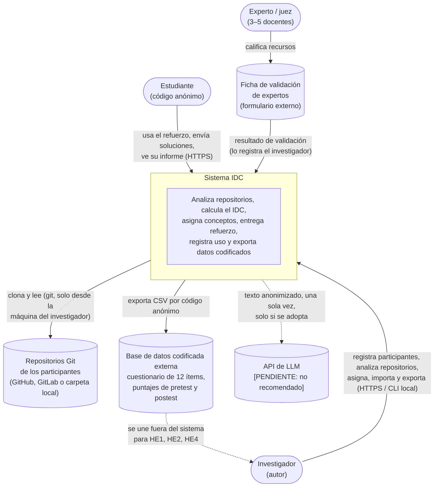
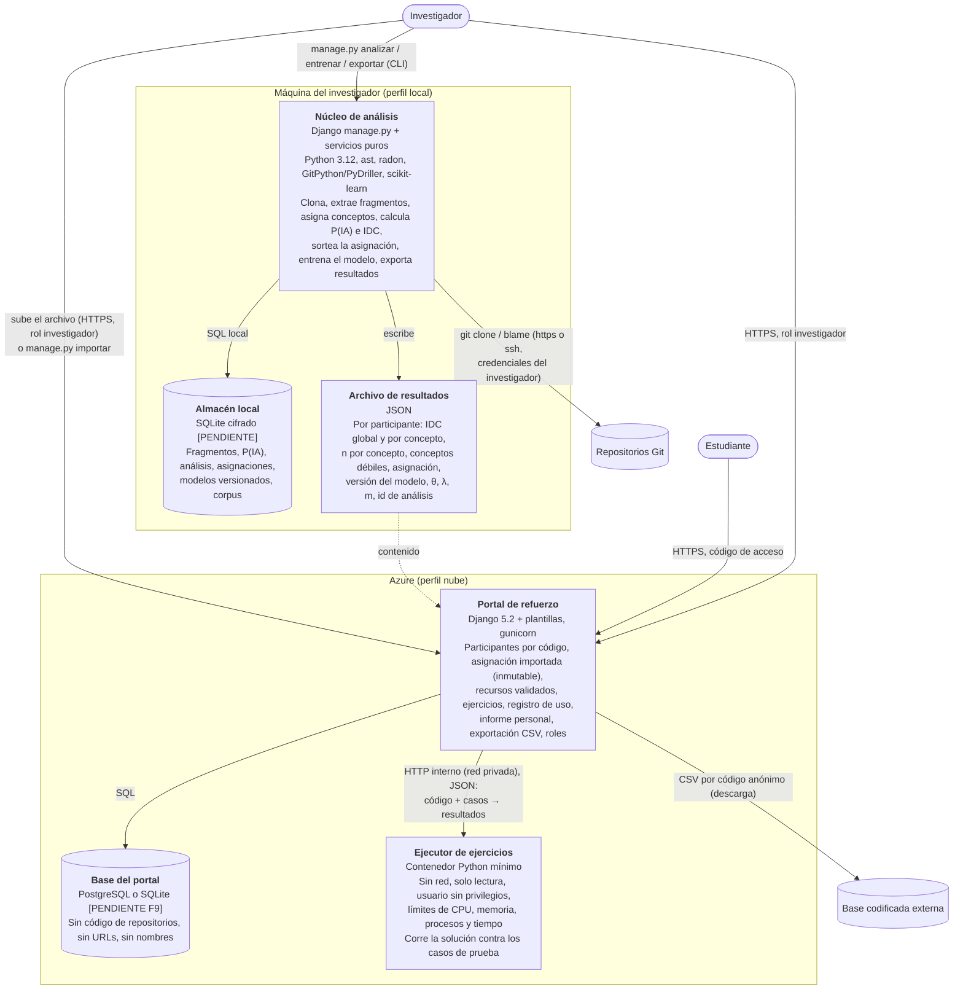

# 04. Contexto, contenedores y estilo arquitectónico

- Fase: F4 / Prompt P4
- Fecha: 2026-11-09
- Entrada: `01-requisitos.md` (RF, RNF), `02-escenarios.md` (ESC), `03-riesgos-spikes.md` (RT, RV, SP).
- Decisión registrada en `adr/ADR-001-estilo-arquitectonico.md`.

Nota sobre los diagramas: Mermaid tiene una sintaxis C4 experimental que muchos visores no renderizan; se usa `flowchart` con la semántica de C4 (personas, sistema, contenedores, sistemas externos).

## 1. Contexto (C4 nivel 1)

Un hecho del plan gobierna este nivel: **el análisis de repositorios ocurre una sola vez, en la semana 8, y lo ejecuta el investigador** (plan 9.7). El postest es la prueba de desempeño, no un nuevo análisis del código (01, PR-03). Por tanto el análisis es una tarea por lotes del investigador, y lo único que los estudiantes usan a diario, durante las semanas 9 a 12, es el refuerzo.

| Elemento | Tipo | Por qué está | Origen |
| --- | --- | --- | --- |
| Estudiante | Persona | Usa el refuerzo (RF-16 a RF-19), ve su informe (RF-31), se retira (RF-30) | 01 |
| Investigador | Persona | Único con acceso completo; ejecuta el análisis y la asignación; importa y exporta | RF-28, plan 9.6 |
| Experto | Persona | Valida recursos; según la simplificación aceptada en la revisión de F2, lo hace en una ficha externa y el investigador registra el resultado (RF-20 → Should, RF-21 fuera) | 01, revisión F2 |
| Repositorios Git | Sistema externo | Fuente de los fragmentos. Se acceden **solo desde la máquina del investigador**, con sus credenciales; el servidor en la nube nunca clona ni guarda URLs | RF-01, ESC-06, RT-10 |
| Base de datos codificada externa | Sistema externo | El plan (9.5) registra cuestionario y pruebas fuera del sistema y les incorpora el IDC exportado | RF-23, RF-26, RF-27 |
| Ficha de validación | Sistema externo | Instrumento del plan (9.3); formulario externo | RF-20 |
| API de LLM | Sistema externo opcional | Solo si se decide usarlo (RT-05, ESC-11). Recomendación: no en este estudio | [PENDIENTE] |
| Correo | — | No aparece: el plan no prevé notificaciones; el investigador contacta a los participantes directamente. Añadirlo sería alcance extra | 01, sección 5 |

## 2. Comparación de estilos

Los tres estilos se evalúan contra los escenarios de 02 y la restricción de tiempo (6 semanas, una persona; RT-06). Puntuación: ✔ cumple bien, ~ cumple con esfuerzo, ✘ cumple mal o encarece.

| Criterio (escenarios) | (a) Monolito modular Django con trabajos en segundo plano | (b) Servicios separados por módulo | (c) CLI por lotes + portal mínimo |
| --- | --- | --- | --- |
| **Privacidad del código** (ESC-06, ESC-07, ESC-11; RT-10; plan 9.6) | ~ El servidor en la nube clona los repositorios, necesita credenciales de repos privados y guarda fragmentos y URLs: hay que cifrar todo en la nube y rechazar URLs con token | ✘ Igual que (a) y además el código viaja entre servicios | ✔ El código solo se procesa en la máquina del investigador; a la nube sube únicamente el IDC agregado y la asignación. La tabla código–nombre y los fragmentos quedan donde el plan los quiere: "solo en poder del investigador" |
| **Aislamiento de ejecución** (ESC-08; RT-04) | ~ El portal necesita un ejecutor aislado | ~ Igual | ~ Igual: el portal sigue ejecutando ejercicios; no cambia |
| **Reproducibilidad** (ESC-12 a ESC-15) | ✔ Si se versiona modelo y parámetros | ~ Versiones de varios servicios que alinear | ✔ Un comando con entradas explícitas (commit, modelo, θ, λ, m) es la forma más natural de reproducir |
| **Trazabilidad** (ESC-16 a ESC-20) | ✔ Todo en una base | ~ Repartida | ~ Dos almacenes: fragmentos y P(IA) en local, IDC y asignación en el portal. Se une por un identificador de análisis que viaja en la importación |
| **Integridad del diseño** (ESC-18, ESC-19) | ✔ | ✔ | ✔ El portal recibe la asignación ya sorteada y la trata como inmutable |
| **Exactitud del clasificador** (ESC-01 a ESC-05) | Neutral | Neutral | Neutral; el entrenamiento es por lotes en cualquier estilo |
| **Simplicidad y operación** (ESC-21 a ESC-25; RNF-13) | ~ Un despliegue, pero con trabajos en segundo plano, cola o hilos, límites de tiempo de clonado y Git instalado en el servidor | ✘ Varios despliegues, red entre servicios, autenticación entre ellos: sobredimensionado para 25 usuarios | ✔ El portal no tiene tareas largas ni Git; el análisis corre donde ya funciona (el prototipo lo hace hoy en local) |
| **Rendimiento** (RNF-09; RT-12) | ~ Clonado y `git blame` en el servidor; exige segundo plano para no bloquear | ~ | ✔ Irrelevante en la nube; en local, 25 repositorios en una jornada |
| **Costo** (RNF-14) | ~ Servidor con más CPU y disco para clonados | ✘ Más instancias | ✔ Portal mínimo |
| **Tiempo de desarrollo** (RT-06) | ~ El prototipo ya es esto, pero falta: segundo plano, límites, cifrado del código en la nube, gestión de credenciales de repos | ✘ Semanas de infraestructura | ✔ El prototipo ya separa `servicios/` (sin Django) de `persistencia.py`; falta un comando de análisis local y una importación al portal: estimación 2–3 días [PENDIENTE: validar en F10] |
| **Módulo 3** [PENDIENTE] | ~ Corrección de T1–T3 en el servidor | ~ | ✔ Corrección de T1–T3 como otro comando por lotes sobre las soluciones recogidas en la sesión supervisada, sin que el estudiante toque el sistema durante la prueba |
| **Riesgo principal** | Código de todos los participantes en un servidor público | Complejidad | Paso manual: el investigador importa 25 resultados una vez (semana 8). Tentación de volver a meter el análisis en el portal |

**Recomendación: (c), CLI por lotes + portal mínimo**, con una implementación que no rompe el prototipo: **un solo proyecto Django con dos perfiles de ejecución**.

- **Perfil local (núcleo de análisis):** el mismo proyecto, en la máquina del investigador, con la app `analisis` activa, base local cifrada y comandos `manage.py` para analizar, entrenar, asignar y exportar un archivo de resultados. Aquí viven fragmentos, P(IA), modelo y repositorios clonados.
- **Perfil nube (portal de refuerzo):** el mismo proyecto desplegado en Azure, con la app `analisis` **deshabilitada** (sin Git, sin modelo, sin clonado), que importa el archivo de resultados y sirve el refuerzo, registra uso, marca validaciones y exporta CSV.

Por qué así y no un paquete Python independiente: el prototipo ya tiene los servicios sin Django; separar el paquete sería más limpio pero costaría una semana de reestructuración y dos sistemas de pruebas. Con dos perfiles, el código es uno, las pruebas son unas, y la separación se garantiza con una bandera de configuración y con que la imagen de la nube no incluya Git ni el modelo. Si en F10 sobra tiempo, el paquete independiente es la evolución natural.

Qué cambia respecto al stack de partida de `CLAUDE.md` y su costo:

| Cambio | Antes (CLAUDE.md) | Ahora | Costo |
| --- | --- | --- | --- |
| Estilo | Preferencia por monolito modular con trabajos en segundo plano | CLI por lotes (local) + portal mínimo (nube), mismo código | 2–3 días para el comando de análisis, el archivo de resultados y la importación [PENDIENTE] |
| Trabajos en segundo plano | Previstos | **No hacen falta**: el análisis es local y por lotes; el portal solo ejecuta ejercicios de ≤ 5 s | Ahorro |
| Sandbox Docker sin red | Previsto | Se mantiene, como contenedor separado del portal | Igual (SP-04) |
| LLM por API | Previsto | No en línea. Si se adopta, se usa una vez en local para generar recursos que luego revisan los expertos y se importan como texto | Ahorro; decisión [PENDIENTE] |
| transformers (CPU) para perplejidad | Previsto | Solo en el perfil local, y solo si SP-07 lo justifica | Condicional |
| PostgreSQL | Previsto | Portal: PostgreSQL o SQLite [PENDIENTE F9]; local: SQLite cifrado [PENDIENTE mecanismo, F6] | Neutral |
| Django, scikit-learn, ast, radon, GitPython/PyDriller, pandas/scipy | Previstos | Sin cambio | — |

## 3. Contenedores (C4 nivel 2)

| Contenedor | Tecnología | Responsabilidad (una línea) | Consumidores |
| --- | --- | --- | --- |
| Núcleo de análisis | Django `manage.py` (comandos) sobre los servicios puros; Python 3.12, ast, radon, GitPython/PyDriller, scikit-learn | Convertir un repositorio en IDC y asignación, y un corpus en modelo versionado, de forma reproducible | Investigador (CLI); Archivo de resultados |
| Almacén local | SQLite cifrado [PENDIENTE: cifrado del archivo o del disco; F6] | Guardar fragmentos, probabilidades, análisis, asignaciones, modelos y corpus bajo control exclusivo del investigador | Núcleo de análisis |
| Archivo de resultados | JSON con esquema versionado | Transportar al portal lo mínimo para operar el refuerzo y exportar, sin código ni rutas | Portal (importación) |
| Portal de refuerzo | Django 5.2, plantillas del servidor, gunicorn, whitenoise [VERIFICAR versiones al construir] | Entregar el refuerzo asignado, registrar uso, bloquear el control, marcar recursos validados, generar informe y exportar CSV; roles investigador y estudiante | Estudiante, Investigador, Base externa |
| Base del portal | PostgreSQL o SQLite [PENDIENTE F9] | Persistir participantes (código), asignaciones, recursos, intentos, aperturas, validaciones, auditoría | Portal |
| Ejecutor de ejercicios | Contenedor Python mínimo con límites (SP-04) | Ejecutar una solución contra casos de prueba y devolver el resultado sin acceso a nada más | Portal |

Reglas de separación que hacen válido el estilo:

1. La imagen del portal **no incluye Git, ni GitPython/PyDriller, ni el modelo, ni la app `analisis` activa**. Si alguien intenta analizar en la nube, falla por diseño.
2. El archivo de resultados **no contiene** código, rutas, URLs, correos ni hashes de commit; solo agregados por concepto, la asignación, los parámetros y un identificador de análisis que permite volver al almacén local (ESC-16, ESC-20).
3. La asignación se sortea en el núcleo y el portal la importa como inmutable; rehacerla exige borrar e importar de nuevo con registro de auditoría (ESC-18).
4. El ejecutor está en red privada y sin salida; el portal es su único cliente (ESC-08).

## 4. Dónde corre cada tarea pesada

| Tarea | Contenedor | Modo | Cuándo | Nota |
| --- | --- | --- | --- | --- |
| Clonado del repositorio y lectura del historial (`git blame`) | Núcleo de análisis (local) | Por lotes | Semana 8 (y spikes) | Con credenciales del investigador; el clon se borra al terminar |
| Extracción de fragmentos, reglas de concepto y rasgos de estilo | Núcleo (local) | Por lotes | Semana 8 | Segundos por repositorio (RNF-09 se mide en SP-06) |
| Rasgos de perplejidad [condicional SP-07] | Núcleo (local) | Por lotes | Semana 8 | Solo CPU del investigador; nunca en el portal |
| Entrenamiento y evaluación del clasificador | Núcleo (local) | Por lotes | Semanas 2–7 | Semillas y partición registradas (ESC-13) |
| Cálculo de IDC y sorteo de asignación | Núcleo (local) | Por lotes | Semana 8 | Instantáneo |
| Generación de recursos de refuerzo (plantillas; o LLM una sola vez [PENDIENTE]) | Núcleo (local) | Por lotes, una vez por concepto | Semanas 5–7 | Los expertos revisan antes de importar (RF-22) |
| Importación de resultados y recursos | Portal | Síncrona (archivo pequeño) | Semana 8 | Valida el esquema y rechaza cualquier campo con código o ruta |
| Ejecución de la solución de un ejercicio | Ejecutor | Síncrona, ≤ 5 s [PENDIENTE] | Semanas 9–12 | El portal espera la respuesta; es la única operación con tiempo acotado |
| Corrección automática de T1–T3 y métricas de calidad [PENDIENTE módulo 3] | Núcleo (local), reutilizando el mismo ejecutor en local | Por lotes | Semanas 8 y 13 | Sobre las soluciones recogidas en la sesión supervisada |
| Exportación CSV e informe personal | Portal | Síncrona | Semanas 13–16 | Tablas pequeñas (25 participantes) |

## 5. Lo que este nivel deja para fases siguientes

- F5: componentes dentro del núcleo y del portal, esquema del archivo de resultados, interfaz del ejecutor, comandos del CLI, diagrama de secuencia completo.
- F6: qué guarda exactamente el almacén local y el portal, mecanismo de cifrado, borrado por participante en ambos lados.
- F8: diseño del ejecutor (SP-04), roles del portal, auditoría de importaciones.
- F9: servicio de Azure que soporte portal + ejecutor en red privada; respaldo del almacén local.

---

**Supuestos**
- El análisis del repositorio se hace una sola vez por participante, en la semana 8; no hay análisis "post" (PR-03 descartada salvo que digas lo contrario).
- El investigador tiene una máquina propia donde puede guardar datos cifrados durante el estudio.
- Importar 25 resultados a mano, una vez, es aceptable.
- El juicio de expertos se hace en una ficha externa (simplificación aceptada en la revisión de F2).

**Decisiones que debes tomar**
1. ~~Estilo~~ **Aprobado 2026-11-09:** estilo (c) con dos perfiles (ADR-001 aceptado).
2. ~~LLM~~ **Aprobado:** sin LLM.
3. ~~Corrección de T1–T3 en local~~ **Aprobado:** cierra el módulo 3 (RF-24, RF-25 por lotes).
4. Mecanismo de cifrado del almacén local (F6) y base del portal (F9). **Sigue abierta.**

**Riesgos**
- Dos almacenes exigen disciplina: si el identificador de análisis no viaja en el archivo, se pierde la trazabilidad (ESC-16).
- La bandera de perfil puede quedar mal puesta y el portal acabar con la app de análisis activa; la mitigación es que la imagen de la nube no tenga Git ni el modelo.
- El paso manual de importación es un punto de error humano en la semana 8; la importación debe validar el esquema y ser idempotente.

**Siguiente paso**
- Revisión de fase de este archivo y del ADR-001. Luego `/clear` y P5 (componentes e interfaces), que debe definir el esquema del archivo de resultados y los comandos del CLI.
