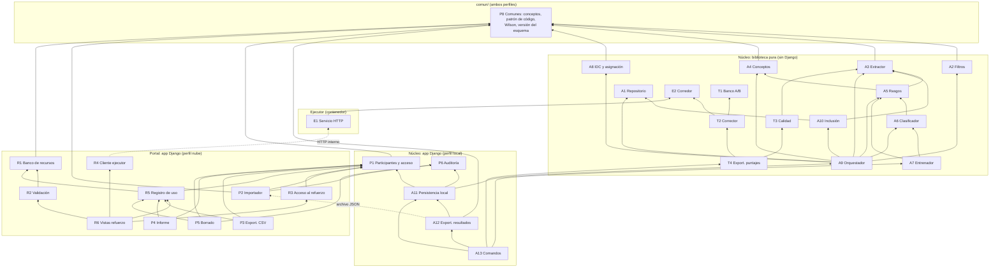

# 05. Componentes e interfaces

- Fase: F5 / Prompt P5
- Fecha: 2026-11-09
- Entrada: `04-contexto-contenedores.md`, `adr/ADR-001-estilo-arquitectonico.md`, `01-requisitos.md`. También `CLAUDE.md` (decisiones del 2026-11-09).
- Sin implementación: solo firmas, contratos y diagramas.

## 0. Dos ajustes al prompt, señalados antes de continuar

1. **Pydantic no está en el stack** (`CLAUDE.md`: Django 5.2; el prototipo usa `dataclasses` congeladas en `servicios/`). Las interfaces internas se expresan con `dataclasses(frozen=True)` y `Protocol`; la frontera con el portal se expresa como **esquema JSON** del archivo de resultados; las entradas web se validan con formularios de Django. Añadir Pydantic sería una dependencia más para lo mismo.
2. **"Endpoints" tiene tres formas** con ADR-001: comandos de `manage.py` en el núcleo (perfil local), rutas HTTP en el portal (perfil nube) y una sola operación HTTP en el ejecutor. Se documentan las tres.

Nombres de los contenedores (04): **Núcleo** (perfil local), **Portal** (perfil nube), **Ejecutor** (contenedor aislado), **Archivo de resultados** (JSON).

## 1. Componentes por módulo

Cada componente tiene una responsabilidad y un archivo previsto. "Existe" indica si el prototipo ya lo tiene (aunque haya que ajustarlo).

### Módulo 1: análisis (Núcleo)

| ID | Componente | Responsabilidad única | Archivo previsto | Existe |
| --- | --- | --- | --- | --- |
| A1 | Ingesta de repositorio | Abrir una ruta local o clonar una URL con límite de tiempo, exponer archivos, HEAD, historial (`blame`), número de commits y de autores; borrar el clon al cerrar | `analisis/servicios/repositorio.py` | Sí |
| A2 | Filtro de archivos | Decidir qué archivos `.py` entran: excluir pruebas, carpetas de entorno, migraciones, dependencias; reglas versionadas | `analisis/servicios/filtros.py` | Parcial (dentro de A1) |
| A3 | Extractor de fragmentos | Parsear con `ast`, producir un `Fragmento` por función o método, marcar triviales, calcular líneas y complejidad | `analisis/servicios/extraccion.py` | Sí |
| A4 | Reglas de concepto | Asignar a cada fragmento cero o más conceptos por reglas sobre el AST; versión de reglas explícita | `analisis/servicios/conceptos.py` | Sí (sin versión) |
| A5 | Extractor de rasgos | Convertir fragmento + historial en un vector de rasgos con nombres estables; perplejidad como rasgo enchufable y opcional (SP-07) | `analisis/servicios/caracteristicas.py`, `perplejidad.py` | Sí (sin perplejidad) |
| A6 | Clasificador | Cargar un modelo versionado y devolver P(IA) por fragmento, calibrada si el modelo lo es | `analisis/servicios/clasificador.py` | Sí (sin calibración) |
| A7 | Entrenador y evaluador | Entrenar con partición por autor y tarea, calibrar, calcular métricas (precisión, sensibilidad, F1, FP a θ, calibración), empaquetar el modelo con su versión y metadatos | `analisis/servicios/entrenamiento.py` | Parcial |
| A8 | IDC y asignación | IDC global y por concepto con intervalo de Wilson; estados (débil / no débil / datos insuficientes); sorteo escalonado A/B/C según `modo`; orden AB/BA por bloques permutados con su propio flujo aleatorio (ADR-004) | `analisis/servicios/idc.py` | Parcial (solo caso A) |
| A9 | Orquestador | Encadenar A1→A8 para un repositorio y devolver un `ResultadoAnalisis` sin tocar la base | `analisis/servicios/flujo.py` | Sí |
| A10 | Verificador de inclusión | Comprobar ≥ 10 commits y ≥ 5 funciones propias no triviales (RF-02) | `analisis/servicios/inclusion.py` | No |
| A11 | Persistencia local | Guardar y leer análisis, fragmentos, probabilidades, asignaciones en el almacén local | `analisis/persistencia.py`, `analisis/models.py` | Sí |
| A12 | Exportador de resultados | Producir el archivo de resultados JSON (esquema `resultados-v1`) sin código, rutas, URLs ni hashes; y CSV locales de auditoría | `analisis/servicios/resultados.py` | Parcial (CSV) |
| A14 | Índice por historial | Calcular por participante el índice de delegación por historial a partir de `insercion_commit`, separado del clasificador (D9) | `analisis/servicios/historial.py` | No |
| A13 | Comandos | Entrada de línea de comandos del núcleo: `analizar`, `congelar_asignacion`, `entrenar`, `evaluar`, `verificar_inclusion`, `exportar_resultados`, `corregir_prueba`, `muestrear_validacion` (D7), `controlar_solapamiento` (D21) | `analisis/management/commands/` | No |

### Módulo 2: refuerzo (Portal)

| ID | Componente | Responsabilidad única | Archivo previsto | Existe |
| --- | --- | --- | --- | --- |
| R1 | Banco de refuerzo por bloques | 8 bloques por concepto (24 en total). Cada bloque: explicación breve, 1 ejemplo resuelto y 3 ejercicios graduados con casos de prueba; con `concepto`, `semana`, `orden` y `version` (D20, RF-37). Se carga desde archivos del repositorio y no se edita en línea. **Separado del banco de la prueba**, que no sale del perfil local (D21) | `refuerzo/bloques/*.json`, `refuerzo/servicios/banco.py`, `manage.py cargar_bloques` | Hecho (pieza 9); el contenido de los 24 bloques está pendiente de autoría. Hay 1 bloque de ejemplo por concepto (`--ejemplo`) |
| R2 | Validación y liberación | Registrar por bloque si los expertos lo validaron (RF-20). Entregar solo los bloques validados y ya liberados: 2 por semana, contados desde la fecha de inicio de la intervención (RF-22, RF-37) | `refuerzo/models.py` (`Bloque`), `refuerzo/servicios/liberacion.py` | No |
| R3 | Control de acceso al refuerzo | Decidir, para participante y concepto, si el material está disponible: reforzado, control (bloqueado), liberado tras el postest, sin asignar (RF-19) | `refuerzo/servicios/acceso.py` | Parcial (403 para control) |
| R4 | Cliente del ejecutor | Enviar código y casos al Ejecutor y traducir su respuesta; aplicar tiempo límite del lado del portal | `refuerzo/servicios/ejecutor.py` | Parcial (subproceso local) |
| R5 | Registro de uso | Guardar aperturas e intentos con fecha, resultado, `bloque_id` y versión; los intentos sobre el control bloqueado; la longitud y el hash de la solución, sin su código. Calcular la adherencia (RF-18, RF-37) | `refuerzo/persistencia.py`, `refuerzo/models.py` | Parcial (sin bloque ni versión; guarda el código) |
| R6 | Vistas de refuerzo | Páginas del estudiante: mis conceptos, material, envío de solución, resultado | `refuerzo/views.py`, `templates/refuerzo/` | Sí |

### Módulo 3: pruebas (Núcleo, por lotes)

| ID | Componente | Responsabilidad única | Archivo previsto | Existe |
| --- | --- | --- | --- | --- |
| T1 | Banco de pruebas A/B | Enunciados T1–T3 de cada forma, con sus casos de prueba y la **solución de referencia de cada ítem**, versionados. La referencia sirve para calcular `cc_ref` y `lin_ref` (D1) | `pruebas/banco/forma_A.json`, `forma_B.json` | No |
| T2 | Corrector de corrección funcional | Ejecutar cada solución contra los casos de su ítem y calcular el porcentaje superado (RF-24), reutilizando el corredor del Ejecutor en local | `pruebas/servicios/corrector.py` | No |
| T3 | Métricas de calidad | Complejidad ciclomática media por función y longitud media de funciones de cada solución (RF-25), con radon | `pruebas/servicios/calidad.py` | No (radon ya en A3) |
| T4 | Exportador de puntajes | CSV en formato largo: una fila por participante × concepto × momento, con `forma`, `orden`, `T_pct`, `cc_sol`, `cc_ref`, `lin_sol` y `lin_ref` (D17). **No lleva** `reforzado`, `caso` ni la semilla, para mantener ciegos a los calificadores (D3). La unión con la asignación y con Q se hace después (06 §2) (RF-23) | `pruebas/servicios/exportacion.py` | No |

### Plataforma

| ID | Componente | Responsabilidad única | Archivo previsto | Perfil | Existe |
| --- | --- | --- | --- | --- | --- |
| P1 | Participantes y acceso | Participante por código anónimo; código de acceso del estudiante; sesión de estudiante; investigador con autenticación de Django; sin rol experto (RF-01, RF-28) | `plataforma/models.py`, `plataforma/acceso.py` | Ambos | Parcial (sin acceso) |
| P2 | Importador de resultados | Validar el archivo contra el esquema, rechazar campos prohibidos, crear o actualizar participantes y asignaciones de forma idempotente, registrar auditoría (ESC-18) | `plataforma/servicios/importacion.py` | Nube | No |
| P3 | Exportador CSV | Tablas por código anónimo: participantes, análisis por concepto, intentos, aperturas (RF-27) | `plataforma/servicios/exportacion.py` | Nube | Sí (en `analisis`) |
| P4 | Informe personal | Página imprimible por participante con su IDC por concepto, intervalos, conceptos trabajados y uso del refuerzo (RF-31) | `plataforma/servicios/informe.py` | Nube | No |
| P5 | Borrado | Eliminar todo lo de un participante (portal) y guía para el almacén local; borrado total al concluir (RF-30) | `plataforma/servicios/borrado.py` | Ambos | No |
| P6 | Auditoría | Registro inmutable de importaciones, liberaciones del control, borrados y rehechos de asignación | `plataforma/models.py` (`Auditoria`) | Nube | No |
| P7 | Configuración y perfil | θ, λ, m vigentes (local); bandera `PERFIL = local | nube` que activa o desactiva apps y comandos | `config/settings.py`, `config/perfiles.py` | Ambos | Parcial |
| P8 | Comunes | Constantes compartidas por los dos perfiles: nombres de conceptos, formato del código anónimo, `intervalo_wilson`, versión del esquema de resultados | `comun/` | Ambos | No (repartido) |
| E1 | Ejecutor: servicio | Recibir código + casos por HTTP interno, lanzar el corredor en un proceso con límites, devolver resultado | `ejecutor/servidor.py` | Contenedor | No |
| E2 | Ejecutor: corredor | Proceso hijo que importa la solución, corre cada caso y escribe JSON | `ejecutor/corredor.py` | Contenedor y Núcleo (T2) | Sí |

Nota para F10: hoy `analisis/` mezcla la biblioteca pura (`servicios/`) con la app de Django (modelos, vistas). Para que el perfil nube no cargue la app de análisis pero el portal pueda usar las constantes, lo compartido debe vivir en `comun/`. La separación física de carpetas es trabajo de F10; aquí solo se fija la regla de dependencias (sección 4).

## 2. Pipeline del módulo de análisis

Cada etapa recibe y devuelve tipos concretos. El orden difiere en un punto del prompt: la **asignación de concepto va justo después de la extracción**, porque ambas trabajan sobre el AST y los conceptos no dependen de la probabilidad; ponerla después obligaría a reparsear.

| # | Etapa | Componente | Entrada | Salida | Nota |
| --- | --- | --- | --- | --- | --- |
| 1 | Ingesta del repositorio | A1 | `origen: str` (ruta o URL), `tiempo_limite_s` | `Repositorio` (contexto): `archivos()`, `commit_head`, `n_commits`, `n_autores`, `tiene_historial` | El clon se borra al salir del contexto |
| 2 | Verificación de inclusión | A10 | `Repositorio` | `ResultadoInclusion(n_commits, n_funciones, cumple, motivos)` | Dos momentos. El mínimo de commits se comprueba al abrir. El mínimo de funciones **propias** se comprueba **después del filtro por autor** (etapa 6c, D19). Las dos pueden detener el análisis. Un repositorio sin historial no pasa el mínimo de commits, así que el filtro siempre tiene autoría |
| 3 | Filtrado de archivos | A2 | `Iterable[ArchivoFuente]`, `ReglasFiltro` | `Iterator[ArchivoFuente]` | Reglas versionadas (`FILTROS_VERSION`) |
| 4 | Parsing y extracción | A3 | `ArchivoFuente` (ruta, contenido) | `list[Fragmento]`; `ErrorSintaxis` por archivo | Un fragmento por función o método; anidadas se funden en la envolvente |
| 5 | Asignación de concepto | A4 | `Fragmento.nodo` (AST) | `frozenset[str]` ⊆ {`recursion`, `estructuras_datos`, `excepciones`} | `REGLAS_CONCEPTO_VERSION` |
| 6 | Historial por fragmento | A1 | `Repositorio`, ruta, líneas | `insercion_commit: int | None` | `None` sin historial. **No entra al clasificador (D9)**: alimenta solo el índice de delegación por historial (A14) |
| 6c | Filtro por autor | A1 | `Fragmento`, autor del commit mayoritario (en memoria), `hashes_correos` del participante, sal local | `bool` propio; contador `n_fragmentos_otros_autores` | HMAC-SHA256 en memoria; el correo de terceros no se guarda ni hasheado (D19, RF-36). Los ajenos se descartan antes de clasificar |
| 7 | Rasgos | A5 | `codigo`, `Perplejidad | None` | `VectorRasgos` (orden = `NOMBRES_CARACTERISTICAS`) | Solo estilo y estructura (`rasgos-v2`). La perplejidad, solo si el modelo se entrenó con ella |
| 8 | Probabilidad calibrada | A6 | `list[VectorRasgos]`, `ModeloCargado` | `list[float]` P(IA) ∈ [0,1] | `ModeloCargado.calibrado` dice si pasó por calibración (SP-03) |
| 9 | IDC con intervalo | A8 | `Iterable[(p_ia, conceptos)]`, `Parametros(theta, lambda_, m)` | `ResultadoIDC(idc_global, ic95, n, n_ia, conceptos: tuple[ResultadoConcepto])` | Wilson al 95 %; `estado` por concepto |
| 9b | Índice de delegación por historial | A14 | `Iterable[insercion_commit]`, umbral N | `IndiceHistorial(valor | None, n_con_historial)` | Exploratorio para HE1 (D9); `historial-v1`; vacío si no hay historial |
| 10 | Asignación de conceptos y orden de formas | A8 | Todos los `ResultadoIDC`, `semilla_base`, `modo` | `Reparto(reforzados, control, caso, exploratorio, semilla)` por participante y `orden` AB/BA | **No ocurre dentro de `analizar`.** Es un paso por lotes (`congelar_asignacion`) que se ejecuta cuando todos tienen diagnóstico, antes del pretest (ADR-004; D2, D3, R2, R3) |
| 11 | Persistencia | A11 | `ResultadoAnalisis`, `Participante`, `Parametros`, `ModeloCargado` | `Analisis` (con `analisis_id` UUID) | Transacción única |
| 12 | Exportación | A12 | `Iterable[Analisis]` | `ArchivoResultados` (JSON) | Sin código, rutas, URLs ni hashes |

## 3. Interfaces

### 3.1 Tipos de dominio (dataclasses congeladas, `comun/` y `analisis/servicios/`)

```python
# comun/tipos.py
CONCEPTOS: Final = ("recursion", "estructuras_datos", "excepciones")
PATRON_CODIGO_ANONIMO: Final = r"^[A-Z]{1,3}\d{2,4}$"
ESQUEMA_RESULTADOS: Final = "resultados-v1"

def intervalo_wilson(n_ia: int, n: int, z: float = 1.959964) -> tuple[float, float] | None: ...

@dataclass(frozen=True)
class Parametros:
    theta: float          # umbral de P(IA)
    lambda_: float        # umbral de IDC por concepto
    m: int                # fragmentos mínimos por concepto

# analisis/servicios/tipos.py
@dataclass(frozen=True)
class ArchivoFuente:
    ruta: str             # relativa a la raíz del repositorio
    contenido: bytes

@dataclass(frozen=True)
class Fragmento:
    archivo: str
    nombre: str
    codigo: str
    linea_inicio: int
    linea_fin: int
    lineas: int
    complejidad: int
    conceptos: frozenset[str]
    trivial: bool

@dataclass(frozen=True)
class VectorRasgos:
    valores: tuple[float, ...]        # mismo orden que NOMBRES_CARACTERISTICAS
    nombres: tuple[str, ...]

@dataclass(frozen=True)
class FragmentoClasificado:
    fragmento: Fragmento
    insercion_commit: int | None
    p_ia: float

@dataclass(frozen=True)
class ResultadoConcepto:
    concepto: str
    n_fragmentos: int
    n_ia: int
    idc: float | None
    ic95: tuple[float, float] | None
    estado: Literal["debil", "no_debil", "datos_insuficientes"]

@dataclass(frozen=True)
class ResultadoIDC:
    idc_global: float | None
    ic95: tuple[float, float] | None
    n_fragmentos: int
    n_ia: int
    conceptos: tuple[ResultadoConcepto, ...]
    @property
    def debiles(self) -> list[str]: ...
    @property
    def calculables(self) -> list[str]: ...

@dataclass(frozen=True)
class Reparto:
    reforzados: tuple[str, ...]
    control: tuple[str, ...]
    caso: Literal["A", "B", "C"]   # ADR-004; reemplaza a `comparable`
    exploratorio: bool
    semilla: int

@dataclass(frozen=True)
class ResultadoInclusion:
    n_commits: int
    n_funciones_propias: int
    cumple: bool
    motivos: tuple[str, ...]

@dataclass(frozen=True)
class ResultadoAnalisis:
    fragmentos: tuple[FragmentoClasificado, ...]
    resultado: ResultadoIDC
    inclusion: ResultadoInclusion
    commit_head: str                  # se queda en local; nunca va al archivo de resultados
    tiene_historial: bool
    n_autores: int | None
    n_triviales: int
    archivos_con_error: tuple[str, ...]
    versiones: Versiones

@dataclass(frozen=True)
class Versiones:
    modelo: str
    reglas_concepto: str
    filtros: str
    rasgos: str
    codigo_sistema: str               # commit o etiqueta del propio sistema
```

### 3.2 Firmas del Núcleo

```python
# A1 analisis/servicios/repositorio.py
class Repositorio(Protocol):
    commit_head: str
    tiene_historial: bool
    n_commits: int
    n_autores: int | None
    def archivos(self) -> Iterator[ArchivoFuente]: ...
    def insercion_commit(self, ruta: str, linea_inicio: int, linea_fin: int) -> int | None: ...

def abrir_repositorio(origen: str, *, base: Path | None = None,
                      tiempo_limite_s: int = 300) -> ContextManager[Repositorio]:
    """Lanza ErrorRepositorio si no se puede abrir, clonar o si la URL trae credenciales."""

# A2 analisis/servicios/filtros.py
FILTROS_VERSION: Final = "filtros-v1"
def filtrar(archivos: Iterable[ArchivoFuente], reglas: ReglasFiltro = REGLAS_V1) -> Iterator[ArchivoFuente]: ...

# A3 analisis/servicios/extraccion.py
def extraer_funciones(codigo: str, ruta: str = "") -> list[Fragmento]:
    """Lanza ErrorSintaxis si el archivo no parsea."""

# A4 analisis/servicios/conceptos.py
REGLAS_CONCEPTO_VERSION: Final = "conceptos-v1"
def detectar_conceptos(funcion: ast.FunctionDef | ast.AsyncFunctionDef) -> frozenset[str]: ...

# A5 analisis/servicios/caracteristicas.py, perplejidad.py
RASGOS_VERSION: Final = "rasgos-v2"   # sin historial (D9)
NOMBRES_CARACTERISTICAS: Final[tuple[str, ...]]
class Perplejidad(Protocol):
    version: str
    def __call__(self, codigo: str) -> float: ...
def extraer_caracteristicas(codigo: str,
                            perplejidad: Perplejidad | None = None) -> VectorRasgos: ...

# A14 analisis/servicios/historial.py
HISTORIAL_VERSION: Final = "historial-v1"
@dataclass(frozen=True)
class IndiceHistorial:
    valor: float | None          # None si ningún fragmento tiene historial
    n_con_historial: int
def indice_por_historial(inserciones: Iterable[int | None], *, umbral_lineas: int) -> IndiceHistorial: ...

# A6 analisis/servicios/clasificador.py
@dataclass(frozen=True)
class ModeloCargado:
    version: str
    es_demo: bool
    calibrado: bool
    rasgos_version: str
    usa_perplejidad: bool
    theta_recomendado: float | None   # el que fijó SP-03, si existe
    metricas: Mapping[str, float]
    def predecir(self, entradas: Sequence[tuple[str, int | None]]) -> list[float]: ...
def cargar_modelo(ruta: Path) -> ModeloCargado:
    """Lanza ModeloNoDisponible o ModeloIncompatible (rasgos_version distinta)."""

# A7 analisis/servicios/entrenamiento.py
@dataclass(frozen=True)
class Particion:
    estrategia: Literal["por_autor", "por_tarea", "dejar_asistente_fuera"]
    semilla: int
    asistente_fuera: str | None = None
@dataclass(frozen=True)
class ResultadoEntrenamiento:
    version: str
    metricas: Mapping[str, float]     # precision, sensibilidad, f1, auroc, fp_a_theta, ece
    particion: Particion
    ruta_modelo: Path
    hash_corpus: str
def entrenar(corpus: Path, *, salida: Path, version: str, particion: Particion,
             calibrar: bool, usa_perplejidad: bool, es_demo: bool) -> ResultadoEntrenamiento: ...
def evaluar(modelo: ModeloCargado, conjunto: Path, theta: float) -> Mapping[str, float]: ...

# A8 analisis/servicios/idc.py
def calcular_resultados(fragmentos: Iterable[tuple[float, Iterable[str]]],
                        parametros: Parametros) -> ResultadoIDC: ...
def repartir_conceptos(resultado: ResultadoIDC, semilla: int, *,
                       exploratorio: bool) -> Reparto:
    """Asignación escalonada (ADR-004): elegibles = débiles (A) | calculables (B) | los 3 (C);
    hasta 2 reforzados y al menos 1 de control. exploratorio=True omite el caso A."""
def derivar_semilla(semilla_base: int, *partes: str) -> int: ...   # SHA-256, nunca hash() de Python
def sortear_orden(codigos: Sequence[str], semilla_base: int, *,
                  tamano_bloque: Literal[2, 4] = 4) -> dict[str, Literal["AB", "BA"]]: ...
    # bloques permutados en el orden de los códigos; |#AB − #BA| ≤ 1 (R2)

# A9 analisis/servicios/flujo.py
def analizar_repositorio(origen: str, modelo: ModeloCargado, parametros: Parametros,
                         *, perplejidad: Perplejidad | None = None,
                         base: Path | None = None) -> ResultadoAnalisis: ...

# A10 analisis/servicios/inclusion.py
def verificar_inclusion(repositorio: Repositorio, fragmentos: Sequence[Fragmento],
                        *, minimo_commits: int = 10, minimo_funciones: int = 5) -> ResultadoInclusion: ...

# A11 analisis/persistencia.py
def ejecutar_analisis(participante: Participante, *, forzar_rehacer: bool = False) -> Analisis:
    """Lanza AsignacionCongelada si ya existe análisis y no se pide rehacer;
    rehacer borra la asignación anterior y lo anota en Auditoria."""

# A12 analisis/servicios/resultados.py
def exportar_resultados(analisis: Iterable[Analisis]) -> dict:   # conforme a ESQUEMA_RESULTADOS
def validar_sin_datos_prohibidos(documento: dict) -> list[str]:  # rutas, URLs, correos, hashes, código

# T2–T4 pruebas/servicios/
def corregir_item(solucion: str, item: ItemPrueba, *, tiempo_limite_s: float = 5.0) -> ResultadoItem: ...
def metricas_calidad(solucion: str) -> MetricasCalidad:   # cc, lineas, n_funciones (se aplica a la solución y a la referencia)
def corregir_prueba(soluciones: Path, forma: Literal["A", "B"], momento: Literal["pre", "post"],
                    banco: BancoPruebas) -> list[PuntajeItem]: ...   # sin datos de asignación (D3)
```

### 3.3 Comandos del Núcleo (`manage.py`, perfil local)

| Comando | Argumentos | Efecto | Salida | Códigos de salida |
| --- | --- | --- | --- | --- |
| `analizar` | `--participante P01 --repo <ruta|url> [--sin-perplejidad]` | Ejecuta el pipeline con los parámetros vigentes y el modelo configurado, y guarda el análisis. **No sortea.** Si el participante ya tenía un análisis y la asignación no está congelada, lo reemplaza y lo deja en auditoría (R5, RF-40) | Resumen en consola: inclusión, n propios, n de otros autores, indeterminados, IDC por concepto con IC, `analisis_id` | 0 ok; 2 no cumple inclusión; 3 repositorio inaccesible; 4 sin funciones propias; 5 asignación ya congelada: no se puede reanalizar; 6 modelo no disponible |
| `congelar_asignacion` | `--semilla-base N [--tamano-bloque 2|4]` | Exige que `modo` esté fijado y que todos los participantes activos tengan diagnóstico. En una transacción: sortea los conceptos (A/B/C) de cada uno y el orden AB/BA de toda la muestra, y registra la fecha de congelación. Se ejecuta una sola vez | Tabla de casos y órdenes; conteo #AB/#BA | 0; 10 falta algún diagnóstico o `modo`; 11 ya congelada |
| `muestrear_validacion` | `--n 150 --calibracion 20 --semilla N --salida <carpeta>` | Muestra estratificada según la salida de las reglas (≥ 30 positivos esperados por concepto, más los indeterminados y los no asignados), exportada a ciegas para los anotadores (D7, R4) | Archivos para anotar, sin la salida de las reglas | 0 |
| `controlar_solapamiento` | `[--banco <dir>]` | Compara el banco de la prueba con el material de refuerzo vigente. Mide la similitud de los enunciados (Jaccard de palabras) y la de la estructura AST de las soluciones de referencia con los ejemplos resueltos, y lista los pares sospechosos (D21). Umbrales provisionales: 0,5 y 0,8 | Tabla de pares para revisión manual | 0; 12 hay pares sobre el umbral; 14 banco inválido |
| `entrenar` | `--corpus datos/corpus.jsonl --salida datos/modelos/<v>.joblib --version <v> --particion por_autor|por_tarea --semilla N [--calibrar] [--perplejidad] [--demo]` | Entrena, evalúa en el conjunto de prueba de la partición, empaqueta | Métricas y ruta; registro en `datos/experimentos.jsonl` | 0; 7 corpus inválido |
| `evaluar` | `--modelo <ruta> --conjunto <jsonl> --theta X [--asistente-fuera <nombre>]` | Métricas en un conjunto externo; FP a θ; curva para fijar θ | Tabla y CSV de la curva | 0; 6 |
| `verificar_inclusion` | `--repo <ruta|url>` | Solo la etapa 2, sin rasgos ni modelo | `cumple`, motivos | 0 cumple; 2 no cumple; 3 |
| `exportar_resultados` | `--salida resultados.json [--participantes P01,P02]` | Escribe el archivo de resultados del último análisis por participante y lo valida contra datos prohibidos | Archivo + resumen | 0; 8 datos prohibidos detectados (no escribe) |
| `corregir_prueba` | `--momento pre|post --soluciones <carpeta> --salida puntajes.csv [--banco <dir>]` | Exige la asignación congelada. La **forma sale del orden** de cada participante: AB es A en el pretest y B en el postest. Corre T1–T3 y las métricas de calidad de la solución y de la referencia. Escribe una fila por participante × concepto × momento, sin columnas de asignación (D3, D17). Corregir de nuevo reemplaza los puntajes | CSV para la base externa; `PuntajeItem` en el almacén local | 0; 9 hay soluciones ilegibles (sigue con las demás); 13 asignación no congelada; 14 banco inválido o referencia que no pasa sus casos; 15 no existe la carpeta |
| `exportar_banco` | `--salida banco.json` | Serializa el banco de recursos con versión y hash, para importarlo en el portal | Archivo | 0 |

Convención: `--repo` acepta ruta local o URL **sin** usuario, token, parámetros ni fragmento; si los trae, código 3 y no se guarda nada.

### 3.4 Rutas del Portal (perfil nube)

Autenticación: estudiante por **código de acceso** (distinto del código anónimo, lo genera el investigador y se entrega en persona); investigador con usuario y contraseña del sistema de autenticación de Django. No hay rol experto.

| Método | Ruta | Rol | Entrada | Salida | Errores |
| --- | --- | --- | --- | --- | --- |
| GET/POST | `/acceso/` | Público | código de acceso | Sesión de estudiante; redirige a `/mi/` | 400 código inválido; 429 tras N intentos [PENDIENTE] |
| GET | `/mi/` | Estudiante | — | Sus conceptos: reforzado / control (bloqueado) / liberado; sin IDC numérico [decisión: RF-32, ver nota] | 403 |
| GET | `/mi/refuerzo/<concepto>/` | Estudiante | — | Lista de los bloques validados y ya liberados del concepto (2 por semana, D20) | 403 concepto no reforzado antes de liberar el control (se registra como apertura no permitida) |
| GET | `/mi/refuerzo/<concepto>/<bloque_id>/` | Estudiante | — | El bloque; registra la apertura con `bloque_id` y versión | 403 concepto no reforzado o semana futura (se registra el intento); 404 bloque inexistente o sin validar |
| POST | `/mi/refuerzo/<concepto>/<bloque_id>/` | Estudiante | `ejercicio`, `codigo` (≤ 20 000 caracteres) | Resultado por caso, pasados/total, aviso si no usa el concepto. Se guardan la longitud y el SHA-256 del código, no el código | 403 como en GET; 404 ejercicio desconocido. Ejecutor caído: mensaje en la página y el envío no cuenta como intentado |
| GET | `/mi/informe/` | Estudiante | — | Informe personal (solo tras liberar, al final del estudio) | 403 antes de la liberación |
| GET/POST | `/gestion/participantes/` | Investigador | código anónimo, código de acceso | Lista y alta | 400 código no cumple patrón |
| POST | `/gestion/importar/` | Investigador | archivo de resultados JSON | Resumen: creados, actualizados, rechazados; registro en auditoría | 400 esquema inválido; 409 intento de cambiar una asignación ya importada sin `rehacer`; 422 datos prohibidos detectados |
| POST | `/gestion/bloques/<bloque_id>/validar/` | Investigador | `version` (la que vio), `n_jueces` | Bloque validado; auditoría | Mensaje si la versión cambió, si faltan jueces o si ya estaba validado |
| POST | `/gestion/intervencion/inicio/` | Investigador | `fecha` | Inicio de la intervención; auditoría | Mensaje si la fecha no es válida o el control ya se liberó |
| POST | `/gestion/intervencion/liberar/` | Investigador | `confirmo=si` | Abre los tres conceptos para todos (D4); fecha de liberación = ahora; auditoría | Mensaje si falta confirmar, si no hay inicio o si ya está liberado |
| GET | `/gestion/exportar/<tabla>.csv` | Investigador | `tabla ∈ {participantes, analisis, intentos, aperturas, adherencia}` | CSV por código anónimo | 404 |
| POST | `/gestion/participantes/<codigo>/borrar/` | Investigador | confirmación | Borra todo lo del participante en el portal; auditoría; recuerda borrar en local | 404 |
| GET | `/gestion/auditoria/` | Investigador | — | Registro de importaciones, liberaciones, borrados, rehechos | — |

Nota sobre `/mi/`, decidida por el asesor (D11): el estudiante **no ve su IDC en las semanas 9–12**, solo los conceptos que trabaja. El IDC con su intervalo aparece en el informe personal (RF-31, RF-34), con el texto de interpretación, **después del postest**. El portal no muestra el IDC hasta que se registra la liberación.

### 3.5 Interfaz del Ejecutor (contenedor, red interna)

| Método | Ruta | Entrada (JSON) | Salida (JSON) | Errores |
| --- | --- | --- | --- | --- |
| POST | `/ejecutar` | `{ "codigo": str, "funcion": str, "casos": [{"args": [...], "esperado": any, "lanza": str|null}], "tiempo_limite_s": float ≤ 10 }` | `{ "casos": [{"paso": bool, "obtenido": str|null, "error": str|null}], "pasados": int, "total": int, "error": str|null, "duracion_ms": int }` | 400 JSON inválido; 413 código > 20 KB; 408 tiempo excedido (el proceso hijo se mata); 500 fallo interno |
| GET | `/salud` | — | `{"ok": true, "version": str}` | — |

Garantías del contrato (se prueban en SP-04 y F8): sin red saliente, sistema de archivos de solo lectura salvo un temporal por petición, usuario sin privilegios, un proceso hijo por petición con límite de memoria y de procesos, limpieza del temporal al terminar, sin acceso a variables de entorno del portal. El mismo `corredor.py` lo usa T2 en local como subproceso.

### 3.6 Esquema del archivo de resultados (`resultados-v1`)

```json
{
  "esquema": "resultados-v1",
  "generado": "2026-05-04T15:20:00-05:00",
  "sistema": {"version_codigo": "v0.3.0"},
  "versiones": {"modelo": "real-v1", "reglas_concepto": "conceptos-v1",
                "filtros": "filtros-v1", "rasgos": "rasgos-v2", "historial": "historial-v1"},
  "modelo": {"es_demo": false, "calibrado": true, "f1_prueba": 0.74},
  "parametros": {"theta": 0.62, "lambda": 0.5, "m": 5},
  "modo": "confirmatorio",
  "participantes": [
    {
      "codigo": "P01",
      "analisis_id": "8d6e3c1a-...",
      "fecha": "2026-05-04T14:55:00-05:00",
      "inclusion": {"n_commits": 14, "n_funciones_propias": 11, "cumple": true},
      "n_fragmentos": 16, "n_ia": 7, "n_triviales": 2, "n_autores": 1,
      "n_fragmentos_otros_autores": 0, "n_indexacion_indeterminada": 3,
      "idc_global": 0.4375, "ic95": [0.23, 0.67],
      "conceptos": [
        {"concepto": "recursion", "n": 4, "n_ia": 4, "idc": null, "ic95": null,
         "estado": "datos_insuficientes", "condicion": "sin_asignar"},
        {"concepto": "estructuras_datos", "n": 8, "n_ia": 4, "idc": 0.5, "ic95": [0.22, 0.78],
         "estado": "debil", "condicion": "reforzado"},
        {"concepto": "excepciones", "n": 5, "n_ia": 3, "idc": 0.6, "ic95": [0.23, 0.88],
         "estado": "debil", "condicion": "control"}
      ],
      "asignacion": {"semilla": 1734021, "debiles": ["estructuras_datos", "excepciones"],
                     "reforzados": ["estructuras_datos"], "control": ["excepciones"],
                     "caso": "A", "orden": "AB", "modo": "confirmatorio",
                     "congelada_en": "2026-05-04T14:55:00-05:00"},
      "indice_historial": {"valor": 0.31, "n_con_historial": 16, "version": "historial-v1"}
    }
  ]
}
```

Reglas del esquema: (1) **campos prohibidos**: código fuente, nombres de archivo, rutas, URLs, correos, nombres de autor, hashes de commit; el exportador y el importador rechazan cualquier cadena que coincida con esos patrones (ESC-06); (2) `analisis_id` es la única llave hacia el almacén local (ESC-16); (3) `codigo` cumple `PATRON_CODIGO_ANONIMO`; (4) la importación es idempotente por (`codigo`, `analisis_id`); un `analisis_id` nuevo para un código ya asignado exige `rehacer` explícito y queda en auditoría (ESC-18); (5) los valores del ejemplo son ilustrativos, no datos.

## 4. Dependencias entre componentes



Verificación de ausencia de ciclos: las flechas apuntan siempre hacia una capa inferior o igual sin volver. Orden topológico válido: `P8` → `A1, A2, A3, A4, T1, E2, P6, R4` → `A5, A10, T3, E1, P1, R1` → `A6, A8, T2, R2, R3, R5` → `A7, A9, T4, R6, P2, P3, P4, P5` → `A11` → `A12` → `A13`. Ninguna flecha va de una posición anterior a una posterior en este orden salvo las dos punteadas, que **no son dependencias de código**: `A12 → P2` es un archivo que el investigador transporta, y `R4 → E1` es una llamada de red a un contrato (3.5). El portal no importa nada del Núcleo salvo `comun/`; el Núcleo no importa nada del portal salvo `P1` y `P6` (modelos compartidos de participante y auditoría, en `plataforma/`, perfil ambos).

Regla para F10 que lo hace verificable: una prueba automatizada que importe cada módulo y falle si `refuerzo/`, `plataforma/` o `ejecutor/` importan `analisis.*`, o si `analisis/servicios/` importa Django.

## 5. Diagrama de secuencia del flujo completo

```mermaid
sequenceDiagram
    autonumber
    actor Est as Estudiante
    actor Inv as Investigador
    actor Exp as Expertos
    participant Nuc as Núcleo (local)
    participant Alm as Almacén local
    participant Por as Portal (nube)
    participant Eje as Ejecutor
    participant Ext as Base externa / fichas

    Note over Inv,Est: Semana 7–8 · consentimiento y alta
    Est->>Inv: Firma consentimiento; recibe código anónimo y código de acceso (en persona)
    Inv->>Por: POST /gestion/participantes/ (código anónimo, código de acceso)
    Est->>Ext: Cuestionario de 12 ítems (formulario externo, con su código)

    Note over Inv,Alm: Semana 8 · diagnóstico (por lotes, local)
    Inv->>Nuc: manage.py verificar_inclusion --repo
    Nuc-->>Inv: cumple / motivos
    Inv->>Nuc: manage.py analizar --participante P01 --repo
    Nuc->>Nuc: clonar → filtrar → extraer → conceptos → filtro por autor → rasgos → P(IA) → IDC
    Nuc->>Alm: guardar análisis y fragmentos (analisis_id), reemplaza el anterior si aún no se congeló
    Nuc-->>Inv: IDC por concepto con IC
    Note over Inv,Alm: Con todos los diagnósticos listos y el modo fijado tras el go/no-go
    Inv->>Nuc: manage.py congelar_asignacion --semilla-base N
    Nuc->>Alm: conceptos A/B/C por participante y orden AB/BA por bloques, con fecha de congelación
    Inv->>Nuc: manage.py exportar_resultados --salida resultados.json
    Nuc->>Nuc: validar sin datos prohibidos
    Inv->>Por: POST /gestion/importar/ (resultados.json)
    Por->>Por: validar esquema, crear asignaciones inmutables, auditoría
    Note over Inv,Est: La asignación ya está congelada antes de esta sesión (D3)
    Est->>Ext: Pretest en la forma que indique su orden AB/BA (D16), en sesión supervisada fuera del sistema
    Inv->>Nuc: manage.py corregir_prueba --forma A|B --momento pre
    Nuc-->>Ext: puntajes.csv (T1–T3, calidad) → base codificada

    Note over Inv,Exp: Semanas 5–8 · recursos y validación
    Inv->>Nuc: manage.py exportar_banco
    Inv->>Nuc: manage.py controlar_solapamiento (banco de prueba frente a banco de refuerzo, D21)
    Inv->>Exp: Ficha de validación por bloque (externa, con la pregunta de no solapamiento)
    Exp-->>Inv: Calificaciones (pertinencia, claridad, corrección, nivel)
    Inv->>Por: POST /gestion/bloques/<id>/validar/
    
    Note over Est,Eje: Semanas 9–12 · refuerzo
    Est->>Por: POST /acceso/ (código de acceso)
    Est->>Por: GET /mi/refuerzo/estructuras_datos/
    Por->>Por: R3: ¿reforzado? sí → R5 registra apertura
    Por-->>Est: explicación, ejemplos, ejercicios
    Est->>Por: POST .../ejercicio/<id>/ (solución)
    Por->>Eje: POST /ejecutar (código, casos, límite)
    Eje-->>Por: casos, pasados/total
    Por->>Por: R5 registra intento (bloque y versión, longitud y hash de la solución)
    Por-->>Est: resultado y retroalimentación
    Est->>Por: GET /mi/refuerzo/excepciones/ (concepto de control)
    Por-->>Est: 403 bloqueado hasta el postest (intento registrado)

    Note over Est,Ext: Semana 13 · postest
    Est->>Ext: Postest en la otra forma (sesión supervisada)
    Inv->>Nuc: manage.py corregir_prueba --forma B|A --momento post
    Nuc-->>Ext: puntajes.csv
    Inv->>Por: POST /gestion/liberar-control/
    Est->>Por: GET /mi/refuerzo/excepciones/ (ahora liberado)

    Note over Inv,Ext: Semanas 14–16 · exportación y cierre
    Inv->>Por: GET /gestion/exportar/analisis.csv, intentos.csv, aperturas.csv
    Inv->>Ext: unir por código anónimo con cuestionario y puntajes
    Est->>Por: GET /mi/informe/
    Inv->>Por: POST .../borrar/ (al concluir) · Inv->>Alm: borrado del almacén local
```

## 6. Estrategia de pruebas por componente

| Componente | Unitarias | De contrato | De integración |
| --- | --- | --- | --- |
| A1 Repositorio | Rechazo de URLs con credenciales; conteo de autores sin guardar correos; `insercion_commit` con y sin historial | — | Clonar `demo_repo/` y un repositorio sin historial; límite de tiempo con un origen inaccesible |
| A2 Filtros | Cada regla de exclusión; versión expuesta | — | — |
| A3 Extractor | Funciones, métodos, anidadas, triviales, errores de sintaxis, codificaciones raras | — | — |
| A4 Conceptos | Un caso positivo y uno negativo por regla; casos límite documentados en SP-05 (indexación de cadenas, recursión mutua, `raise` trivial) | Conjunto dorado de SP-05: la concordancia no baja de la medida al congelar `conceptos-v1` | — |
| A5 Rasgos | Cada rasgo con un fragmento donde el valor es conocido; ningún rasgo de historial en el vector (D9); orden de `NOMBRES_CARACTERISTICAS` estable | Un modelo entrenado con `rasgos-v2` rechaza vectores de otra versión | — |
| A14 Índice por historial | Valor con y sin historial; umbral N en los bordes | — | — |
| A6 Clasificador | Carga, versión, `calibrado`, incompatibilidad de rasgos | El paquete joblib contiene todos los metadatos del esquema de versionado (sección 7) | — |
| A7 Entrenador | Partición por autor no mezcla autores; semilla reproduce métricas | `evaluar` sobre un conjunto fijo produce las mismas cifras en dos corridas | Entrenar con el corpus demo de punta a punta |
| A8 IDC | Wilson en 0/n, n/n, n < m; casos A, B y C en sus bordes; modo exploratorio sin caso A; semilla reproducible; `sortear_orden` con |#AB − #BA| ≤ 1, reproducible en otro proceso e independiente de la semilla de conceptos | — | — |
| A1 Filtro por autor | Repositorio de ejemplo con dos autores: solo entran las funciones del participante; ningún correo, en claro o hasheado de terceros, en la base ni en los CSV | — | `analizar` sobre un repositorio de dos autores |
| A9 Orquestador | — | `ResultadoAnalisis` completo con un modelo simulado | `analizar` sobre `demo_repo/` con el modelo demo |
| A10 Inclusión | Umbrales en el borde (9/10 commits, 4/5 funciones) | — | Con `demo_repo/` |
| A11 Persistencia | Transacción atómica; reanalizar antes de congelar reemplaza y deja auditoría; después de congelar se rechaza (RF-40) | — | `analizar`, `congelar_asignacion` y de nuevo `analizar`: el tercero falla con código 5 |
| A12 Resultados | Detección de datos prohibidos (rutas Windows y Unix, URLs, correos, SHA) | **Esquema JSON `resultados-v1`**: fixture compartida con P2 | `exportar_resultados` → `importar` en una base de portal vacía |
| A13 Comandos | Códigos de salida | Ayuda y argumentos estables | Flujo completo con `demo_repo/` |
| T1–T4 Pruebas | Porcentaje de casos; métricas de radon; soluciones ilegibles | Formato del CSV de puntajes acordado con la base externa [PENDIENTE: columnas, F6] | Corregir una carpeta de soluciones de ejemplo |
| P1 Acceso | Patrón de código; código de acceso no reutilizable; sesiones | — | Login de estudiante e investigador |
| P2 Importador | Esquema inválido; datos prohibidos; idempotencia; 409 sin rehacer | Misma fixture que A12 | Importar y comprobar vistas del estudiante |
| R1–R2 Banco y validación | Carga de los bloques; un bloque no validado o aún no liberado no se entrega; 2 por semana desde la fecha de inicio | Esquema del banco exportado (`exportar_banco`) | `controlar_solapamiento` sobre un par conocido |
| R3 Acceso al refuerzo | Matriz condición × liberado → permitido/403 | — | — |
| R4 Cliente ejecutor | Tiempo límite del lado del portal; errores 503/504 | **Contrato 3.5** con un ejecutor simulado y con el real | Portal + Ejecutor en contenedor: batería hostil de SP-04 |
| R5 Registro de uso | Apertura e intento con bloque y versión; sin código de la solución; intento sobre el control bloqueado registrado; adherencia | — | — |
| P3 Export. CSV | Columnas, sin código ni rutas, formato del código anónimo | Encabezados estables (los consume la estadística) | — |
| P4 Informe | Texto de interpretación con intervalo; sin IDC antes de la liberación | — | — |
| P5 Borrado | Cero registros con el código tras borrar | — | Borrar y exportar: el participante no aparece |
| E1–E2 Ejecutor | Casos que pasan, fallan, lanzan; tiempo excedido; salida gigante | Contrato 3.5 | Batería hostil (SP-04) |
| Regla de dependencias | — | Prueba que falla si `refuerzo/`, `plataforma/` o `ejecutor/` importan `analisis.*` o si `analisis/servicios/` importa Django | — |

## 7. Versionado de todo lo que influye en un puntaje

Objetivo (regla del prompt): dado cualquier IDC o puntaje, poder recomputarlo. La tupla que lo determina es **(commit del repositorio analizado, versión del modelo, versión de reglas de concepto, versión de filtros, versión de rasgos, θ, λ, m, semilla del sorteo, versión del código del sistema)**. Cada elemento se versiona así:

| Artefacto | Dónde se declara la versión | Cómo se registra en cada resultado | Cuándo cambia |
| --- | --- | --- | --- |
| Modelo | Dentro del paquete joblib: `version`, `hash_corpus`, `particion`, `semilla`, `rasgos_version`, `usa_perplejidad`, `calibrado`, `metricas`, `theta_recomendado`, `entrenado_en`; además `datos/experimentos.jsonl` con una línea por entrenamiento | `Analisis.modelo_version` (local) y `versiones.modelo` (archivo de resultados) | Cada entrenamiento produce una versión nueva; nunca se sobrescribe un archivo de modelo |
| θ, λ, m | `Configuracion` vigente (local) | Copiados a cada `Analisis` y al archivo de resultados; cambiarlos no altera análisis anteriores (ESC-14) | Al calibrar en el piloto; cada cambio queda en auditoría |
| Reglas de concepto | `REGLAS_CONCEPTO_VERSION` en `conceptos.py` | `Analisis.reglas_version`; `versiones.reglas_concepto` | Cualquier cambio en una regla exige subir la versión; una prueba compara contra el conjunto dorado de SP-05 |
| Filtros de archivos | `FILTROS_VERSION` | Igual | Igual |
| Rasgos | `RASGOS_VERSION` + `NOMBRES_CARACTERISTICAS` | Dentro del modelo y en el análisis; un modelo rechaza rasgos de otra versión | Al añadir o quitar un rasgo (por ejemplo, perplejidad) |
| Semillas del sorteo | Una semilla base del estudio, dada a `congelar_asignacion`. Las semillas de conceptos (por participante) y de orden (de la muestra) se derivan con SHA-256 | `Asignacion.semilla`, `orden`, `caso`, `modo` y la fecha de congelación; en el archivo de resultados | Nunca: la congelación ocurre una sola vez |
| Commit del repositorio analizado | `Analisis.commit_head` (solo local) | Referenciado por `analisis_id`; **no** sale al portal | — |
| Banco de refuerzo | Cada bloque con `id` y `version`; el banco completo con `hash` al exportar | `bloque_id` y versión en cada intento y apertura; la validación apunta a una versión concreta | Cualquier corrección de un bloque sube su versión y exige revalidarlo (RF-22) |
| Banco de pruebas A/B | `forma_A.json` y `forma_B.json` con `version`, incluidas las soluciones de referencia | En cada fila del CSV de puntajes | Al ajustar un enunciado o una referencia tras el piloto |
| Índice por historial | `HISTORIAL_VERSION` y umbral N | En el archivo de resultados (`indice_historial.version`) | Al cambiar N o la definición |
| Fórmula del puntaje (D1) | Script de análisis estadístico con versión, fuera del sistema | En el informe de resultados | Se fija antes del pretest |
| Definición amplia de conceptos (D5) | `conceptos-v1-amplia` | Segundo cálculo del IDC, solo para el análisis de sensibilidad | Junto con `conceptos-v1` |
| Esquema de resultados | `ESQUEMA_RESULTADOS = "resultados-v1"` | Campo `esquema`; el importador rechaza versiones desconocidas | Al cambiar campos |
| Código del sistema | Etiqueta de Git (`v0.x.y`) | `sistema.version_codigo` en el archivo de resultados; `Analisis.codigo_version` | Cada despliegue o cada corrida de análisis |
| Corpus | `hash_corpus` (SHA-256 del JSONL) + fecha | Dentro del modelo | Cada vez que se añade o quita una muestra |

Procedimiento de reproducción (se documenta en F7 y se prueba en F10): `manage.py analizar --participante P01 --repo <ruta> --commit <sha> --modelo <ruta_versionada> --theta --lambda --m --semilla` con las versiones de código, reglas, filtros y rasgos correspondientes (se obtienen cambiando a la etiqueta de Git) debe producir un `ResultadoIDC` idéntico (ESC-12).

---

**Supuestos**
- El estudiante no ve su IDC durante la intervención, solo en el informe final (decidido por el asesor, D11).
- El banco de recursos se escribe en archivos del repositorio y se importa; no hay editor en línea.
- El código de acceso del estudiante se entrega en persona; no hay correo.
- Los modelos `Participante` y `Auditoria` se comparten entre perfiles (misma app `plataforma`), con tablas separadas en cada base.

**Decisiones que debes tomar**
1. ~~IDC durante la intervención~~: resuelto (D11).
2. Modo exploratorio de la asignación: hay una propuesta en ADR-004, pendiente de que el asesor la confirme.
3. ~~Columnas del CSV~~: resuelto (D17; 06 §2).
4. Límite de intentos de acceso y tamaño máximo del código (20 KB propuesto) [PENDIENTE].

**Riesgos**
- La separación física `comun/` ↔ `analisis/` ↔ `plataforma/` no existe hoy; si F10 no la hace, la regla de dependencias no se puede probar y el perfil nube arrastrará código de análisis.
- El Ejecutor es el componente con más incógnitas de plataforma (SP-04 y F9); el contrato 3.5 está fijado para que el portal no dependa de cómo se resuelva.
- Compartir `Participante` entre perfiles tienta a compartir también la base: nunca; son dos bases con el mismo esquema parcial.

**Siguiente paso**
- Revisión de fase. Después, F6 (datos y privacidad): modelo entidad-relación para **dos almacenes**, diccionario con sensibilidad, qué guarda cada uno del código, borrado en ambos y columnas del CSV de puntajes. Registrar el ADR de la regla de sorteo (RV-04) en F5 o F6 [PENDIENTE: lo hago en F6 si no me lo pides antes].
