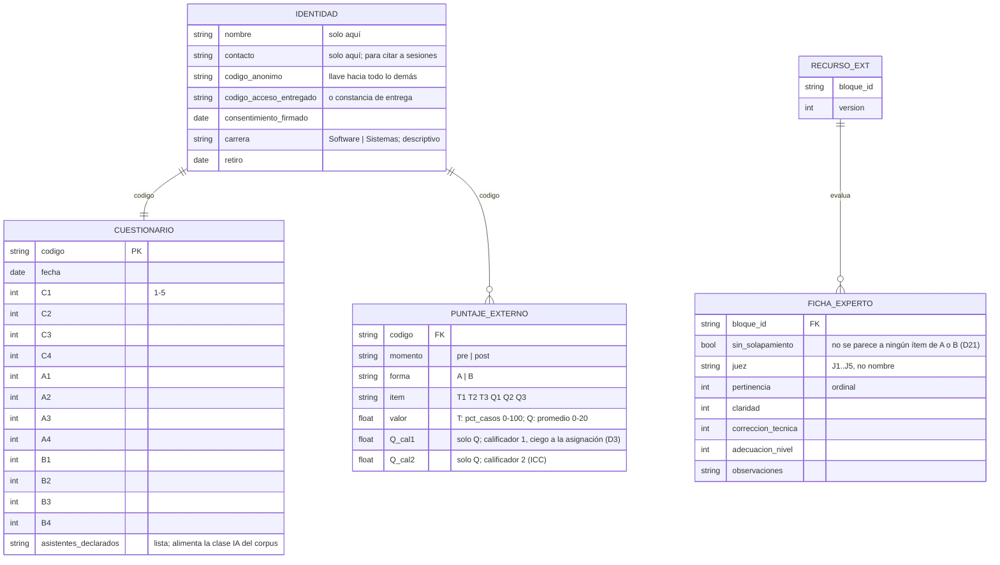

# 06. Datos y privacidad

- Fase: F6 / Prompt P6
- Fecha: 2026-11-09. Actualizado el 2026-11-21 con las decisiones del asesor D1, D2, D3, D11, D13, D14, D15, D16 y D17 (`docs/decisiones/decisiones-asesor-2026-11-21.md`) y con R2, R3, R4, R5, D19, D20 y D21 (`docs/decisiones/decisiones-asesor-2026-11-21b.md`)
- Entrada: `05-componentes-interfaces.md`; `docs/plan/plan.md` secciones 8.3.1 (cuestionario de 12 ítems), 8.3.2 (ítems T1–T3 y Q1–Q3), 9.1.2 (consentimiento, retiro), 9.5 (base de datos codificada), 9.6 (aspectos éticos).
- Regla aplicada en cada tabla: **si un dato no hace falta para una hipótesis o para operar el sistema, no se guarda.** Cada campo lleva la hipótesis, requisito o escenario que lo justifica.

Con ADR-001 hay **tres lugares de datos**, y el diseño consiste en que lo sensible no se mueva de donde nace:

| Lugar | Quién lo controla | Qué contiene | Qué no contiene nunca |
| --- | --- | --- | --- |
| **Almacén local** (máquina del investigador, cifrado) | Investigador | Clones de repositorios, fragmentos de código, rasgos, P(IA), análisis, asignaciones, modelos, corpus, soluciones de T1–T3 | Nombres, correos, URLs de repositorios |
| **Portal** (nube) | Investigador (administra), estudiantes (usan) | Códigos anónimos, códigos de acceso, agregados del IDC con intervalo, asignaciones, recursos, uso del refuerzo, auditoría | Código fuente, rutas, URLs, hashes de commit, nombres |
| **Fuera del sistema** | Investigador | Tabla de identidades (nombre ↔ código), base codificada externa (cuestionario y puntajes), fichas de expertos | Código fuente |

## 1. Modelo entidad-relación

### 1.1 Almacén local (Núcleo)

```mermaid
erDiagram
    PARTICIPANTE_LOCAL ||--o{ ANALISIS : "tiene"
    PARTICIPANTE_LOCAL ||--o| ASIGNACION : "recibe"
    PARTICIPANTE_LOCAL ||--o{ PUNTAJE_ITEM : "obtiene"
    ANALISIS ||--|{ RESULTADO_CONCEPTO : "resume"
    ANALISIS ||--o{ FRAGMENTO : "contiene"
    ANALISIS }o--|| MODELO : "usa"
    ASIGNACION }o--|| ANALISIS : "se basa en"
    PARTICIPANTE_LOCAL ||--o{ AUDITORIA_LOCAL : "genera"

    PARTICIPANTE_LOCAL {
        string codigo PK "^[A-Z]{1,3}\d{2,4}$"
        string carpeta_clon "repos/<codigo>/ (ruta relativa al almacén)"
        date consentimiento_fecha
        string consentimiento_version
        datetime retirado_en "null si activo"
        json hashes_correos "HMAC-SHA256 con sal local de los correos de commit declarados (D19)"
        bool excluido "etiquetado o piloto (D15)"
        string motivo_exclusion
        datetime creado
    }
    ANALISIS {
        uuid analisis_id PK
        string codigo FK
        datetime fecha
        float theta
        float lambda
        int m
        string modelo_version FK
        string reglas_version
        string filtros_version
        string rasgos_version
        string codigo_version "etiqueta Git del sistema"
        string commit_head "sha del repo analizado; nunca sale"
        int n_commits
        bool tiene_historial
        int n_autores
        int n_fragmentos "solo los propios (D19)"
        int n_fragmentos_otros_autores "descartados antes de clasificar (D19)"
        int n_indexacion_indeterminada "R4"
        int n_ia
        int n_triviales
        float idc_global
        bool inclusion_cumple
        json inclusion_motivos
        json archivos_con_error "rutas relativas al repo"
        bool exploratorio
        float indice_historial "null sin historial; historial-v1 (D9)"
    }
    RESULTADO_CONCEPTO {
        uuid analisis_id FK
        string concepto "recursion | estructuras_datos | excepciones"
        int n_fragmentos
        int n_ia
        float idc "null si n < m"
        string estado "debil | no_debil | datos_insuficientes"
    }
    FRAGMENTO {
        int id PK
        uuid analisis_id FK
        string archivo "ruta relativa al repo"
        string nombre "nombre de la función o método"
        text codigo "código de terceros; se borra al concluir"
        int linea_inicio
        int linea_fin
        int lineas
        int complejidad
        json conceptos
        int insercion_commit "null sin historial"
        json rasgos "vector; sobrevive al borrado del código"
        float p_ia
    }
    ASIGNACION {
        string codigo PK_FK
        uuid analisis_base FK
        int semilla
        json debiles
        json reforzados
        json control
        string caso "A | B | C, el efectivamente aplicado (ADR-004)"
        string modo "confirmatorio | exploratorio (R3)"
        string orden "AB | BA, por bloques permutados (D16, R2)"
        datetime congelada_en "anterior al pretest (D3)"
    }
    MODELO {
        string version PK
        string ruta_archivo
        string hash_corpus
        string particion "por_autor | por_tarea | dejar_asistente_fuera"
        int semilla
        bool calibrado
        bool es_demo
        string rasgos_version
        bool usa_perplejidad
        json metricas "precision, sensibilidad, f1, auroc, fp_a_theta, ece"
        float theta_recomendado
        datetime entrenado_en
    }
    PUNTAJE_ITEM {
        int id PK
        string codigo FK
        string momento "pre | post"
        string forma "A | B"
        string item "T1 | T2 | T3"
        string banco_version
        float pct_casos "0-100"
        int casos_pasados
        int casos_total
        float cc_sol
        float cc_ref "de la solución de referencia (D1)"
        int lin_sol
        int lin_ref
        int n_funciones
        bool ilegible
        datetime corregido_en
    }
    AUDITORIA_LOCAL {
        int id PK
        datetime fecha
        string accion "analizar | rehacer | exportar | borrar | cambiar_parametros"
        string codigo "null si global"
        json detalle
    }
```

Fuera de la base pero dentro del almacén local cifrado:
- la **sal del HMAC** de los correos (D19), fuera de Git y respaldada con la clave del almacén, porque si se pierde no se puede repetir el filtro;
- `pruebas/banco/` (formas A y B con sus soluciones de referencia), **solo en local y nunca en el portal** (D21);
- `repos/<codigo>/` (clon), `datos/corpus/*.jsonl` (corpus etiquetado), `datos/modelos/*.joblib`, `datos/experimentos.jsonl`, `pruebas/soluciones/<momento>/<codigo>/T1.py…` (soluciones de la sesión supervisada, hasta corregirlas), `exportaciones/resultados-*.json`.

### 1.2 Portal (nube)

```mermaid
erDiagram
    PARTICIPANTE ||--o| DIAGNOSTICO : "tiene"
    PARTICIPANTE ||--o{ APERTURA : "abre"
    PARTICIPANTE ||--o{ INTENTO : "envia"
    DIAGNOSTICO ||--|{ CONCEPTO_DIAGNOSTICO : "detalla"
    DIAGNOSTICO }o--|| IMPORTACION : "proviene de"
    BLOQUE ||--o| VALIDACION_BLOQUE : "tiene"
    BLOQUE ||--o{ EJERCICIO : "incluye"
    EJERCICIO ||--o{ INTENTO : "recibe"
    BLOQUE ||--o{ APERTURA : "registra"
    IMPORTACION ||--o{ AUDITORIA : "anota"

    PARTICIPANTE {
        string codigo PK "mismo patrón que en local"
        string codigo_acceso_hash "hash con sal; nunca el valor"
        datetime creado
        datetime retirado_en
        datetime informe_liberado_en
    }
    IMPORTACION {
        int id PK
        datetime fecha
        string esquema "resultados-v1"
        string hash_archivo
        json versiones "modelo, reglas, filtros, rasgos, codigo"
        json parametros "theta, lambda, m"
        bool exploratorio
        string usuario
    }
    DIAGNOSTICO {
        string codigo PK_FK
        uuid analisis_id "llave hacia el almacén local"
        int importacion_id FK
        datetime fecha_analisis
        int n_fragmentos
        int n_ia
        int n_autores
        float idc_global
        float ic95_bajo
        float ic95_alto
        bool inclusion_cumple
        int semilla
        json debiles
        json reforzados
        json control
        string caso "A | B | C"
        bool exploratorio
    }
    CONCEPTO_DIAGNOSTICO {
        string codigo FK
        string concepto
        int n_fragmentos
        int n_ia
        float idc
        float ic95_bajo
        float ic95_alto
        string estado
        string condicion "reforzado | control | sin_asignar"
    }
    BLOQUE {
        string id PK "p. ej. recursion-03"
        string concepto
        int semana "1-4 de la intervención (D20)"
        int orden "1-2 dentro de la semana"
        int version
        string hash
        json contenido "explicacion, ejemplo resuelto"
        datetime importado_en
    }
    EJERCICIO {
        string id PK
        string bloque_id FK
        int orden
        string titulo
        string enunciado
        string funcion
        json casos "args, esperado, lanza"
    }
    VALIDACION_BLOQUE {
        string bloque_id PK_FK
        bool validado
        int n_jueces
        date fecha
        string nota
        string usuario
    }
    APERTURA {
        int id PK
        string codigo FK
        string bloque_id FK
        int bloque_version
        string concepto
        datetime fecha
        bool permitida "false = intento sobre control bloqueado"
    }
    INTENTO {
        int id PK
        string codigo FK
        string ejercicio_id FK
        string bloque_id
        int bloque_version
        int pasados
        int total
        json casos "paso por caso, sin código"
        string error "mensaje del ejecutor, truncado"
        bool usa_concepto
        int longitud_codigo
        string hash_codigo
        int duracion_ms
        datetime fecha
    }
    LIBERACION {
        int id PK "una sola fila"
        date inicio_intervencion "semana 1 del refuerzo; libera 2 bloques por semana (D20)"
        datetime fecha_liberacion "desbloqueo del control tras el postest (D4)"
        string usuario
    }
    AUDITORIA {
        int id PK
        datetime fecha
        string usuario
        string accion "importar | rehacer | validar | liberar | borrar | alta"
        string objeto
        json detalle
    }
```

Decisión que cambia el prototipo: **`INTENTO` no guarda el código de la solución**, solo su longitud y hash. Ninguna hipótesis lo necesita (RF-18 pide accesos, intentos y resultados) y es código escrito por el estudiante: código de terceros que no debe vivir en la nube. Si hace falta depurar el ejecutor, se usa el registro del propio ejecutor en memoria, no la base.

### 1.3 Fuera del sistema (controlado por el investigador)



La **tabla de identidades** es un archivo cifrado que vive **solo en la máquina del investigador** (D14). Tiene una clave propia, distinta de la del almacén local, y nunca se sube al portal. El cuestionario, los puntajes Q1–Q3 y las fichas de expertos son formularios o hojas del investigador con el código anónimo como única clave (plan 9.5). El CSV `puntajes.csv` que produce el Núcleo (T1–T3) se pega en `PUNTAJE_EXTERNO`.

## 2. Diccionario de datos

Sensibilidad: **Pública** (sin riesgo), **Interna** (operativa; no identifica), **Personal** (identifica o cuasi-identifica a una persona), **Código** (código fuente de terceros). Solo se listan los campos cuya justificación o sensibilidad no es evidente; los identificadores técnicos (`id`, `fecha`) se omiten.

### Almacén local

| Tabla.campo | Tipo | Descripción | Sensibilidad | Justificación |
| --- | --- | --- | --- | --- |
| PARTICIPANTE_LOCAL.codigo | texto | Código anónimo, clave universal | Interna (es personal solo junto a la tabla de identidades) | RF-01 |
| PARTICIPANTE_LOCAL.carpeta_clon | texto | Carpeta local del clon (`repos/P01/`). **La URL o ruta original no se guarda**: el comando `analizar` la usa y la descarta | Interna | Evita guardar el cuasi-identificador (usuario de GitHub, `C:\Users\Nombre`) |
| PARTICIPANTE_LOCAL.consentimiento_fecha / _version | fecha, texto | Constancia de que se puede analizar | Interna | RF-29, plan 9.6 |
| PARTICIPANTE_LOCAL.retirado_en | fecha-hora | Marca de retiro; dispara el borrado | Interna | RF-30 |
| ANALISIS.theta, lambda, m | decimales, entero | Parámetros usados | Pública | RF-11, ESC-14 |
| ANALISIS.*_version, codigo_version | texto | Versiones de modelo, reglas, filtros, rasgos y sistema | Pública | ESC-12, 05 §7 |
| ANALISIS.commit_head | texto | Commit analizado; permite reproducir. **Nunca sale al portal** (un sha es buscable en GitHub) | Personal (cuasi) | ESC-12 |
| ANALISIS.n_commits, inclusion_* | entero, bool, json | Criterios de inclusión | Interna | RF-02 |
| ANALISIS.n_autores | entero | Número de autores distintos; los correos no se guardan | Interna | RF-35 |
| ANALISIS.archivos_con_error | json | Rutas relativas de archivos no parseables | Código (rutas) | Operativo: avisar al investigador. Se borra con el código |
| ANALISIS.idc_global, n_fragmentos, n_ia | decimal, enteros | IDC y sus conteos | Interna | HE1, HE2, RF-08 |
| ANALISIS.exploratorio | bool | Modo exploratorio activo (F1 < 0,70) | Pública | RF-13 |
| RESULTADO_CONCEPTO.* | — | IDC por concepto y estado | Interna | HE4, RF-09, RF-10 |
| FRAGMENTO.codigo | texto | Código de la función | **Código** | ESC-16 (trazabilidad) y reanálisis; retención limitada (§4) |
| FRAGMENTO.archivo, nombre | texto | Ubicación en el repo; `archivo` puede contener nombres de carpeta elegidos por el estudiante | Código (rutas) | ESC-16; se borran con el código |
| FRAGMENTO.rasgos | json | Vector de rasgos | Interna | Permite auditar P(IA) **después** de borrar el código |
| FRAGMENTO.p_ia, insercion_commit, conceptos, complejidad, lineas | — | Predicción y descriptores | Interna | RF-07, RF-05, RF-06 |
| ASIGNACION.semilla, debiles, reforzados, control, caso, exploratorio, congelada_en | — | Resultado del sorteo escalonado, congelado antes del pretest | Interna; **no se muestra a los calificadores** (D3) | RF-15, ESC-17, ESC-18, ADR-004 |
| ASIGNACION.orden, modo | texto | AB o BA: qué forma recibe en el pretest, por bloques permutados (D16, R2). Modo aplicado (R3) | Interna | D16 (la forma es covariable), R3 |
| ANALISIS.indice_historial | decimal | Índice de delegación por historial | Interna | HE1 exploratoria (D9) |
| ANALISIS.n_fragmentos_otros_autores, n_indexacion_indeterminada | entero | Fragmentos descartados por ser de otros autores; indexaciones sin tipo inferido | Interna | D19, R4 |
| PARTICIPANTE_LOCAL.hashes_correos | json | HMAC-SHA256 con sal local de los correos de commit que declaró el participante. El correo en claro no se guarda; los de terceros solo se hashean en memoria y se descartan | **Personal (seudonimizado)**: con la sal y el correo se puede comprobar la coincidencia. Nunca sale al portal ni a los CSV | D19, RF-36 |
| PARTICIPANTE_LOCAL.excluido, motivo_exclusion | bool, texto | Participante del etiquetado o del piloto | Interna | D15 |
| MODELO.* | — | Metadatos del modelo | Pública | 05 §7 |
| MODELO.hash_corpus | texto | Identifica el corpus usado | Pública | Reproducibilidad |
| PUNTAJE_ITEM.* | — | Corrección de T1–T3 | Interna | RF-24, RF-25, HE4 |
| AUDITORIA_LOCAL.* | — | Quién hizo qué | Interna | ESC-18 |

Archivos del almacén local: `repos/<codigo>/` (**Código**; incluye el historial Git, que contiene nombres y correos de autor en los commits: por eso vive solo aquí), `corpus/*.jsonl` (**Código**, de las personas de la sesión de etiquetado y de asistentes), `pruebas/soluciones/` (**Código**), `modelos/*.joblib` (Interna: un modelo entrenado puede memorizar fragmentos [VERIFICAR: baja probabilidad con modelos tabulares de scikit-learn; sin perplejidad no hay modelo generativo propio]).

### Portal

| Tabla.campo | Tipo | Descripción | Sensibilidad | Justificación |
| --- | --- | --- | --- | --- |
| PARTICIPANTE.codigo | texto | Código anónimo | Interna | RF-01, RF-27 |
| PARTICIPANTE.codigo_acceso_hash | texto | Hash con sal del código de acceso; el valor se entrega en persona y no se puede recuperar | Interna | RF-28, ESC-10 |
| PARTICIPANTE.informe_liberado_en | fecha-hora | Cuándo puede ver su informe | Interna | RF-31 |
| IMPORTACION.hash_archivo, versiones, parametros, exploratorio | — | Qué archivo entró y con qué versiones | Pública | ESC-15, ESC-18 |
| DIAGNOSTICO.analisis_id | uuid | Única llave hacia el almacén local | Interna | ESC-16, ESC-20 |
| DIAGNOSTICO.idc_global, ic95_*, n_* | — | Agregados; sin código | Interna | HE1, HE2, RF-34 |
| DIAGNOSTICO.semilla, debiles, reforzados, control, caso, exploratorio | — | Copia inmutable de la asignación | Interna | RF-15, RF-19, ESC-18 |
| CONCEPTO_DIAGNOSTICO.* | — | IDC por concepto con intervalo y condición | Interna | HE4, RF-27, RF-34 |
| BLOQUE.*, EJERCICIO.* | json, texto | Material de refuerzo en bloques (24: 8 por concepto); **no es código de participantes** | Pública | RF-16, RF-37, D20 |
| VALIDACION_BLOQUE.* | — | Resultado de la ficha externa por bloque | Interna | RF-20, RF-22, HE3 |
| APERTURA / INTENTO.bloque_id, bloque_version | texto, entero | Qué bloque y qué versión se usó | Interna | RF-37 (adherencia y trazabilidad del material) |
| LIBERACION.inicio_intervencion | fecha | Desde cuándo se cuentan las semanas para liberar bloques | Pública | D20 |
| APERTURA.permitida | bool | Distingue uso real de intentos sobre el control bloqueado | Interna | RF-18, RF-19, ESC-19 |
| INTENTO.pasados, total, casos, error, usa_concepto | — | Resultado del ejercicio | Interna | RF-17, RF-18 |
| INTENTO.longitud_codigo, hash_codigo | entero, texto | Describen la solución sin guardarla | Interna | Detectar reenvíos idénticos; **el código no se guarda** |
| INTENTO.error | texto | Mensaje del ejecutor truncado a 500 caracteres [PENDIENTE]; puede contener fragmentos del código del estudiante en un traceback | Código (residual) | Retroalimentación. Mitigación: el ejecutor devuelve solo la última línea del error, sin el código fuente |
| LIBERACION.fecha_liberacion | fecha-hora | Cuándo se abrió el material de control | Pública | RF-19 |
| AUDITORIA.* | — | Importaciones, rehechos, validaciones, liberación, borrados | Interna | ESC-18 |
| Usuario investigador (auth de Django) | — | Credenciales del investigador | Personal (del investigador) | RF-28 |

### Fuera del sistema

| Tabla.campo | Sensibilidad | Nota |
| --- | --- | --- |
| IDENTIDAD.nombre, contacto | **Personal** | Solo en la tabla de identidades; nunca en ninguna base del sistema |
| IDENTIDAD.carrera | Personal (cuasi) | Solo descriptivo de la muestra (plan 9.1); no entra al sistema |
| CUESTIONARIO.C1…B4 | Interna | HE1, HE2 (plan 8.3.1) |
| CUESTIONARIO.asistentes_declarados | Interna | RF-03: define la clase IA del corpus; no entra al sistema, el investigador lo usa al generar el corpus |
| PUNTAJE_EXTERNO.* | Interna | HG, HE2, HE4 (plan 8.3.2) |
| FICHA_EXPERTO.juez | Interna | J1…J5, no el nombre del docente |

### CSV de análisis en formato largo (D17)

El análisis usa un CSV con **una fila por participante × concepto × momento**, con las columnas de la sección 3.4 del documento del asesor. Para mantener ciegos a los calificadores (D3), ese CSV **no lo produce una sola salida del sistema**. Se arma uniendo tres partes por (`participante`, `concepto`, `momento`) **después** de cerrar la calificación:

| Parte | Quién la produce | Columnas |
| --- | --- | --- |
| Puntajes T | `corregir_prueba` (Núcleo) | `participante, concepto, momento, forma, T_pct, cc_sol, cc_ref, lin_sol, lin_ref` + `banco_version`, `ilegible` |
| Rúbrica Q | Calificadores, fuera del sistema y sin acceso a la asignación | `Q_cal1, Q_cal2`, y `Q` como su promedio |
| Asignación e IDC | Exportación del Núcleo [F10: opción `--csv-largo` de `exportar_resultados`] | `orden, reforzado, caso, idc_concepto, idc_lo, idc_hi, n_fragmentos, semilla, version_reglas, version_modelo, theta, lambda, m` |

La unión la hace el script de análisis, con versión. El identificador interno del concepto sigue siendo `estructuras_datos` (terminología fija del proyecto). El asesor escribe `estructuras`, y es el mismo concepto.

### Fórmula del puntaje (D1)

La fórmula está en la sección 3.1 del documento del asesor. El sistema **no la implementa**: guarda los valores crudos por ítem y la solución de referencia de cada ítem por forma. La fórmula vive en el script de análisis, con versión, y se fija por escrito antes del pretest. El análisis de sensibilidad recalcula con `Pen_k = 0`.

## 3. Separación de identidades

| Pregunta | Respuesta |
| --- | --- |
| ¿Dónde vive nombre ↔ código anónimo? | En la **tabla de identidades**: un archivo cifrado, solo en la máquina del investigador, con una contraseña propia distinta de la del almacén. Nunca va al portal (D14). Plan 9.6: "solo estará en poder del investigador". |
| ¿Quién accede? | Solo el investigador. El asesor no la necesita. El comité puede exigir ver el procedimiento, no la tabla [VERIFICAR]. |
| ¿Y los correos de commit (D19)? | El participante los declara al registrarse, y también figuran en su consentimiento. El sistema guarda solo su HMAC con una sal local, y la sal nunca está en Git. Los correos de los compañeros de un repositorio grupal solo se hashean en memoria para compararlos y no se guardan de ninguna forma |
| ¿Qué más identifica? | El **código de acceso** (se entrega en persona y solo se guarda su hash); el **clon del repositorio** (historial Git con nombres y correos de autor: solo en local, nunca se extraen a la base); el **commit_head** (buscable en GitHub: solo en local); la **URL o ruta original** (no se guarda en absoluto). |
| ¿Cómo se asigna el código? | Secuencial por orden de alta (`P01`, `P02`…), sin relación con apellido, carrera ni ciclo. Se genera antes de analizar nada. |
| ¿Puede el estudiante ver datos de otros? | No: `/mi/` solo muestra lo del código de la sesión (ESC-10). No existe ninguna vista con lista de participantes para el rol estudiante. |
| ¿Qué ve el asesor o un revisor? | Los CSV exportados por código anónimo y, si hace falta auditar, el almacén local en presencia del investigador. Nunca la tabla de identidades. |
| ¿Y los docentes de curso? | Nada (plan 9.6, RF-28). |

Prueba de la separación (para F8): un atacante con **copia completa del portal** obtiene códigos, agregados y hashes de acceso; con **copia del almacén local sin la clave** no obtiene nada; con **copia descifrada del almacén local** obtiene código fuente e historial Git (nombres de autor), pero no el cuestionario ni los puntajes; solo la tabla de identidades une todo. Por eso las tres cosas tienen claves distintas y lugares distintos.

## 4. Qué se guarda del código, por cuánto tiempo y cómo se borra

| Dato | Se guarda | Dónde | Por qué | Retención | Borrado |
| --- | --- | --- | --- | --- | --- |
| Archivo completo | No, como tabla | — | Ninguna hipótesis lo necesita; el fragmento basta | — | — |
| Clon del repositorio | Sí | Local, `repos/<codigo>/` | Reproducir el análisis en el mismo commit (ESC-12); recuperar un fragmento (ESC-16) | Hasta **terminar el análisis de datos** (D13) | Borrado de la carpeta y destrucción de la clave del almacén |
| Fragmento (código de la función) | Sí | Local, `FRAGMENTO.codigo` | Trazabilidad fragmento → IDC (ESC-16); validación de reglas (SP-05) | Igual que el clon | `borrar_participante` lo pone a vacío y conserva rasgos, `p_ia` y conceptos |
| Hash del fragmento | Sí | Local | Detectar duplicados entre repositorios y con el corpus (fuga, RV-08) | Hasta terminar el análisis (D13) | Con el resto |
| Rasgos | Sí | Local, `FRAGMENTO.rasgos` | Auditar P(IA) sin el código; reentrenar o recalibrar sin volver a clonar | Hasta terminar el análisis. **Se eliminan** porque derivan de los repositorios (D13) | Con el resto |
| P(IA), IDC, asignación | Sí | Local y portal (agregados) | Todas las hipótesis | En el almacén y en el portal, hasta terminar el análisis. Los **CSV agregados** con código anónimo y sin código fuente se conservan como datos de investigación por el plazo que fije el CEI-USIL (D13) [PENDIENTE: plazo] | Portal: `POST .../borrar/`; local: comando |
| Soluciones de T1–T3 | Sí, como archivos | Local, `pruebas/soluciones/` | Corregir y, si hace falta, recorregir con otra versión del banco | Hasta corregir y validar; como máximo el fin del estudio | Borrado de carpeta |
| Soluciones de ejercicios de refuerzo | **No** | — | Ninguna hipótesis; es código del estudiante en la nube | — | Solo hash y longitud |
| Corpus de la sesión de etiquetado | Sí | Local, `corpus/` | Entrenar y evaluar (RF-12) | Hasta el fin del estudio. Se conserva **solo si** los participantes de la sesión lo consintieron para reutilización. Ese consentimiento es un documento aparte, presentado en la misma solicitud al CEI-USIL (D15) [PENDIENTE: cláusula de reutilización] | Borrado o conservación según consentimiento |
| Historial Git (nombres y correos de autor) | Solo dentro del clon | Local | No se extrae a ninguna tabla; se usa en memoria para `n_autores` e `insercion_commit` | Igual que el clon | Con el clon |
| Rutas y URLs de repositorios | **No** (solo rutas relativas internas al clon) | — | La URL identifica al usuario; la ruta local, al dueño del equipo | — | — |

Procedimiento de borrado por participante (RF-30, ESC-09):
1. Portal: `POST /gestion/participantes/<codigo>/borrar/` elimina `PARTICIPANTE`, `DIAGNOSTICO`, `CONCEPTO_DIAGNOSTICO`, `APERTURA`, `INTENTO`; deja una fila en `AUDITORIA` con el código y la fecha, sin más datos. Verificación: consulta que cuenta filas con ese código en todas las tablas = 0 (salvo auditoría).
2. Local: `manage.py borrar_participante P01` elimina `FRAGMENTO`, `RESULTADO_CONCEPTO`, `ANALISIS`, `ASIGNACION`, `PUNTAJE_ITEM`, `PARTICIPANTE_LOCAL`, la carpeta `repos/P01/` y `pruebas/soluciones/*/P01/`; deja auditoría. Misma verificación.
3. Fuera: eliminar la fila de la tabla de identidades, del cuestionario y de los puntajes externos; anotar el retiro.
4. Plazo: ≤ 7 días desde la solicitud [PENDIENTE, RNF-07]. Los respaldos cifrados anteriores al borrado se destruyen al cierre del estudio o antes si el comité lo exige [VERIFICAR].

Cierre (RF-30; D13), **al terminar el análisis de datos**:
- Se borran todas las carpetas de código y se destruye la clave del almacén local.
- Se borran la base del portal y sus respaldos.
- Se conservan solo los CSV agregados con código anónimo y sin código fuente, como datos de investigación, por el plazo que fije el CEI-USIL [PENDIENTE: plazo].

## 5. Envío de datos a servicios externos

**Decisión vigente (ADR-001): no hay LLM.** Nada del código de los participantes, ni anonimizado, sale hacia un servicio de IA. Esta sección fija lo que tendría que cumplirse **si la decisión se reabriera**, para que no se decida a la ligera.

| Aspecto | Mínimo exigible si se usara un LLM |
| --- | --- |
| Cuándo | Una sola vez por concepto, en local, para redactar recursos que luego revisan los expertos (ESC-11, RT-05). Nunca por estudiante, nunca en línea |
| Qué se envía | Nombre del concepto, el enunciado del ejercicio y los errores típicos **descritos por el investigador**. **No** código de participantes |
| Si se insistiera en enviar código | Anonimización obligatoria antes de salir: renombrar identificadores a `f1, v1…`, eliminar comentarios y docstrings, eliminar literales de cadena largos, eliminar rutas, correos y URLs, eliminar la ruta del archivo; verificar con los mismos patrones de `validar_sin_datos_prohibidos` |
| Consentimiento | Debería decir explícitamente que fragmentos anonimizados pueden enviarse a un proveedor externo nombrado, en qué país se procesan y con qué política de retención [VERIFICAR con el proveedor]; sin esa cláusula, prohibido |
| Registro | Guardar qué se envió, cuándo y la respuesta, para la auditoría del comité |

Otros flujos hacia terceros que **sí** existen y el consentimiento debe cubrir:

| Flujo | Qué sale | Hacia quién | Qué debe decir el consentimiento |
| --- | --- | --- | --- |
| Clonado del repositorio | Nada del participante; el proveedor (GitHub, GitLab) ve que el investigador accede | GitHub/GitLab | Que el investigador accederá al repositorio con el permiso que el participante le dé (colaborador de solo lectura o copia entregada) |
| Portal en Azure | Código anónimo, agregados del IDC, uso del refuerzo, hash del código de acceso | Microsoft Azure. La región es un parámetro de configuración documentado (D14) [PENDIENTE: elegirla en F9]. Autorizado verbalmente por el asesor; **falta la autorización escrita** | Que los datos codificados (sin nombre ni código fuente) se alojan en un servidor en la nube, cifrados, en la región X, hasta terminar el análisis |
| Ejecutor | La solución del ejercicio, en memoria, por segundos | El propio portal (contenedor interno) | Que las soluciones de los ejercicios se ejecutan automáticamente y no se almacenan |
| Formularios externos (cuestionario, fichas) | Respuestas con el código anónimo | Proveedor del formulario [VERIFICAR cuál] | Que las respuestas se recogen en un formulario externo identificado solo por código |

## 6. Ley N.º 29733 y comité de ética

Advertencia: no soy abogado. Todo lo de esta sección debe confirmarlo el asesor o la oficina correspondiente de la universidad, y no se citan artículos para no inventarlos. Según el asesor (D14), la Ley N.° 29733 **se cita en el plan**.

| Exigencia (principio o práctica habitual) | Cómo la cubre el diseño | [VERIFICAR] |
| --- | --- | --- |
| Consentimiento informado, previo, expreso e inequívoco para tratar datos personales | Firma antes del alta (RF-29); el sistema no analiza sin fecha de consentimiento | Si el consentimiento debe ser escrito en papel o vale electrónico; si la universidad tiene formato propio |
| Finalidad determinada y explícita | El consentimiento enumera los usos de §5 y el plan 9.6 (solo investigación; no plagio, no docentes) | Redacción final con el asesor |
| Proporcionalidad / minimización | Regla de este archivo: nada que no sirva a una hipótesis u operación; no se guardan URLs, nombres de autor ni soluciones de ejercicios | — |
| Calidad y actualización | Versionado y auditoría; el participante puede pedir ver sus datos (RF-30 habilita también la consulta) | — |
| Seguridad | Cifrado en reposo en los tres lugares, claves distintas; roles; ejecutor aislado; registro de accesos (F8) | Nivel de seguridad exigido para datos de este tipo |
| Derechos de acceso, rectificación, cancelación y oposición | Acceso: informe personal (RF-31) y consulta al investigador; cancelación: borrado en ≤ 7 días (RF-30); oposición: retiro sin consecuencias (plan 9.1.2) | Plazos legales de respuesta; si hace falta un procedimiento escrito |
| Transferencia a terceros o al extranjero | Portal en Azure, autorizado verbalmente por el asesor (D14); hay que conseguir la **autorización escrita** para el Anexo F. Formularios externos | Si alojar datos **codificados sin nombre** en una región fuera del Perú cuenta como flujo transfronterizo de datos personales; si Azure ofrece región o garantías aceptadas |
| Inscripción de bancos de datos personales | La tabla de identidades es el único banco con datos personales directos; es pequeño y temporal | Si un trabajo de investigación de pregrado debe inscribir el banco ante la autoridad o si la universidad lo cubre |
| Datos de menores | No previsto: estudiantes universitarios | Confirmar que todos los participantes son mayores de edad; si no, consentimiento del tutor |
| Plazo de conservación | El código y sus derivados se borran al terminar el análisis. Los CSV agregados se conservan (D13) | El plazo de los CSV lo fija el CEI-USIL |

Checklist para el comité (se completa en F8 con las pruebas):

- [ ] Consentimiento con: fines, acceso al repositorio, correos de commit que el participante declara y el filtro por autor (en un repositorio grupal solo se analizan sus funciones, D19), análisis automatizado y su naturaleza probabilística, alojamiento en nube de datos codificados (región, cifrado, fecha de borrado), ejecución automática de soluciones sin almacenarlas, formularios externos, registro de uso del refuerzo, no uso disciplinario ni académico, derecho a retiro y borrado, informe personal, contacto del investigador y del comité.
- [ ] Procedimiento de codificación y custodia de la tabla de identidades.
- [ ] Lista de datos que **no** se recogen (nombres de autor de commits, URLs, soluciones de ejercicios, código en la nube).
- [ ] Procedimiento y plazo de borrado por retiro y al cierre; qué se conserva y por qué.
- [ ] Declaración de que el IDC se presenta como estimación con intervalo y de que el estudiante no lo ve en las semanas 9–12, solo en el informe final (D11).
- [ ] Lista de espera: el material del concepto de control se desbloquea después del postest (D4).
- [ ] Consentimiento aparte para la sesión de etiquetado (RT-02, D15): documento propio en la misma solicitud al CEI-USIL. Sus participantes aportan código al corpus y quedan fuera de la muestra.
- [ ] Autorización escrita del alojamiento en Azure (D14, Anexo F).
- [ ] Spikes sin repositorios de compañeros antes de la aprobación (D12).

---

**Supuestos**
- La tabla de identidades cabe en un archivo cifrado o en papel; no hace falta software para ella.
- El investigador tiene un equipo propio donde cifrar el almacén local y hacer respaldos cifrados.
- Los participantes son mayores de edad.
- Los CSV agregados sin código son "resultados", no "datos a eliminar".

**Decisiones que debes tomar**
1. ~~Fin del estudio y qué se conserva~~: resuelto (D13). Falta que el CEI fije el plazo de los CSV.
2. Aceptar que `INTENTO` no guarde el código de las soluciones (cambio respecto al prototipo).
3. ~~Columnas del CSV y fórmula~~: resuelto (D17, D1).
4. Región de Azure (F9) y proveedor de formularios, para escribir el consentimiento. Conseguir la autorización escrita de Azure (D14).
5. Cómo se asigna el orden AB/BA a cada participante (D16 no lo dice).

**Riesgos**
- Los tracebacks del ejecutor pueden filtrar líneas de código del estudiante al portal (`INTENTO.error`): hay que recortarlos en el ejecutor, no en el portal.
- El historial Git dentro del clon contiene nombres y correos: si alguien copia `repos/` sin cifrar, hay datos personales. El cifrado del almacén local no es opcional.
- El ciego de los calificadores (D3) depende de que la unión de los tres CSV se haga después de cerrar la calificación. Si se une antes, los calificadores pueden ver `reforzado`.

**Siguiente paso**
- Revisión de fase. Después F7 (clasificador y evaluación), que necesita los resultados de SP-06, SP-05, SP-02, SP-01 y SP-03; si aún no existen, F7 saldrá con los umbrales marcados [PENDIENTE] y habrá que volver a ella.
